# MAX! via CUL

[](https://github.com/thnow/MAX-via-Cul/actions/workflows/validate.yml)
[](https://github.com/thnow/MAX-via-Cul/security/code-scanning)
[](https://scorecard.dev/viewer/?uri=github.com/thnow/MAX-via-Cul)

Home Assistant custom integration for eQ-3 MAX! devices connected through a
CUL or CUNO running CULFW.

This integration is for people who still have working MAX! heating hardware.
eQ-3 has discontinued the MAX! system: the MAX! Cube with its software and app
still works, but gets no updates any more. This integration takes over the
Cube's job in Home Assistant: it talks directly to a CUL/CUNO (or a MAX! Cube
flashed with a-culfw) over TCP or USB and implements the MAX!/MORITZ protocol
itself, fully local.

> [!IMPORTANT]
> **You need a CUL/CUNO radio or a MAX! Cube flashed with [a-culfw](https://github.com/heliflieger/a-culfw).**
> A MAX! Cube with its original eQ-3 firmware does **not** work with this
> integration – it talks the MAX! radio protocol itself, through CULFW.
> Flashing replaces the Cube's firmware; the eQ-3 software and app no longer
> work with it afterwards.

[](https://my.home-assistant.io/redirect/hacs_repository/?owner=thnow&repository=MAX-via-Cul&category=integration)

## What You Get

- UI setup through Home Assistant config flow
- Pairing for MAX! heating thermostats, wall thermostats and shutter contacts
- `climate` entities for heating and wall thermostats
- Week profile editing with draft, save and discard workflow
- Comfort, eco, window-open and measurement-offset configuration entities
- Real MAX! group IDs and link partners written to the devices
- Virtual MAX! shutter contacts for external sensors such as Zigbee, Matter or IKEA
- Services for room association, topology export/import and repair workflows
- Diagnostics for last seen, last ACK, retries, stale state, pending config and profile validation
- Lovelace week profile card: coloured timeline per day, status, inline editing,
  one card for several thermostats of a room
- Optional external room sensor per radiator thermostat (virtual wall
  thermostat), e.g. a thermometer on the desk instead of the sensor behind the
  curtain
- Vacation mode: whole flat (or selected rooms) to e.g. 16 °C until your
  return; the thermostats switch back to their program on their own, with
  optional preheating and restore of manual settings
- Fast, confirmed commands: the CUL's real send budget, prioritized queue and
  device acknowledgements; detection of devices still paired with an old Cube
- Dashboard cards for pairing (name, area and room links in one step), the
  vacation and the transmission queue
- Presets `eco`/`comfort` for schedulers, `−`/`+` until the next switching point

## Screenshots

| Week profile card | Editing a day |
|---|---|
| 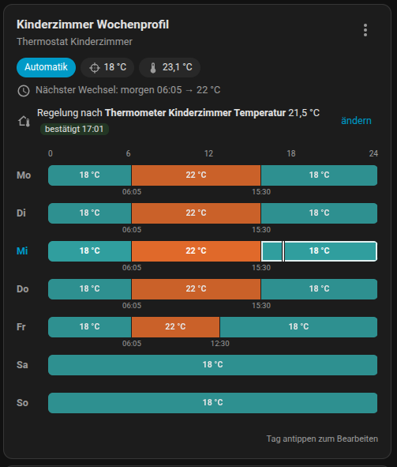 | 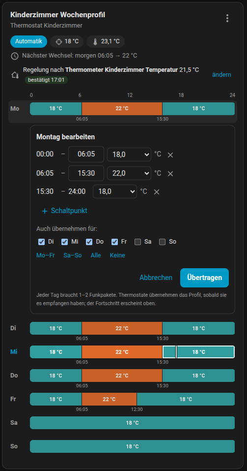 |

| Room sensor instead of the radiator sensor | One card for a room with two thermostats |
|---|---|
| 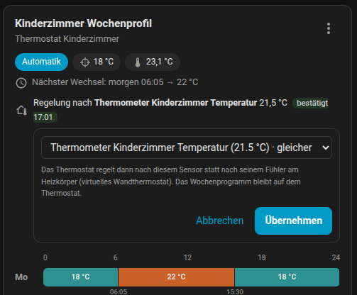 | 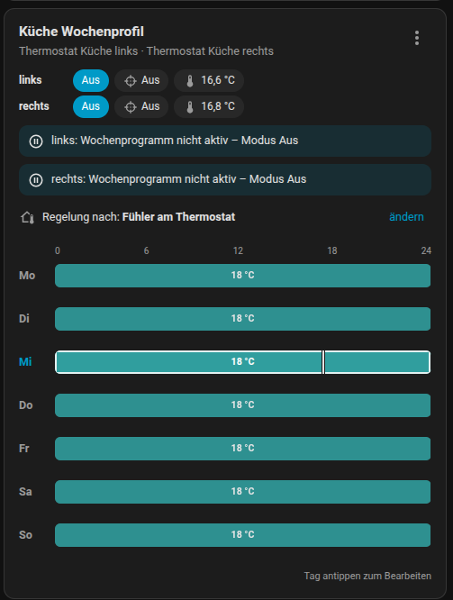 |

| Vacation for the whole flat | Vacation running |
|---|---|
| 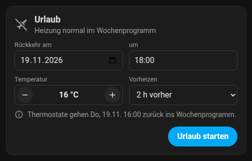 | 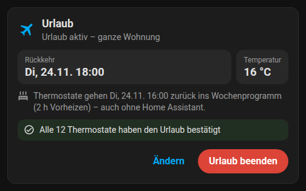 |

| Summer mode: off or valve fully open | Summer mode running |
|---|---|
| 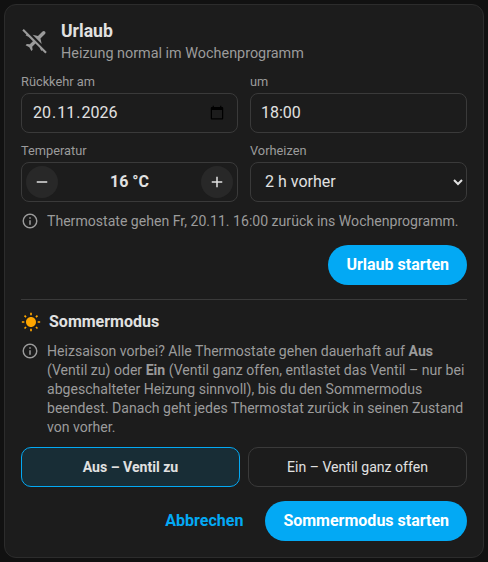 | 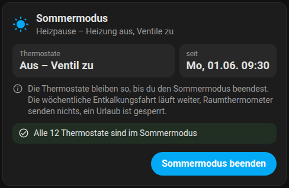 |

| Pairing with name and area | What waits for radio time |
|---|---|
| 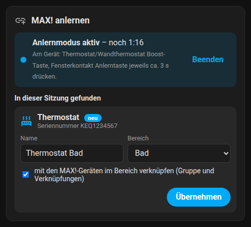 | 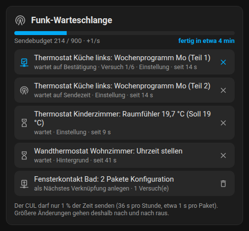 |

**Topology picture** (image entity on the CUL device: rooms, devices, links, problems)

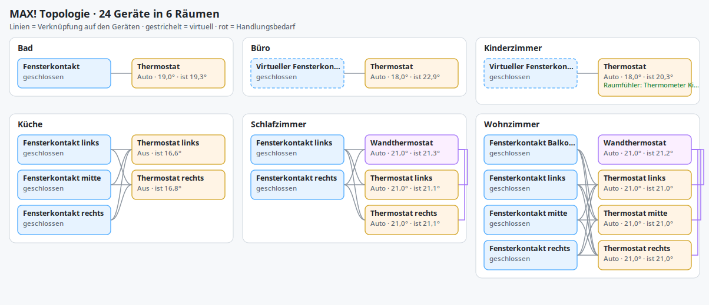

## Supported Devices

- MAX! heating thermostat
- MAX! heating thermostat+
- MAX! wall thermostat
- MAX! shutter contact
- MAX! push button (Eco Taster): presses arrive as an event entity
- Virtual MAX! shutter contacts created by this integration

## Requirements

- Home Assistant 2026.11 or newer
- A CUL or CUNO flashed with CULFW, or a MAX! Cube flashed with
  [a-culfw](https://github.com/heliflieger/a-culfw) – a Cube with its original firmware does not work
- Connected via TCP (commonly port `2323`) or as a USB stick (e.g. CUL,
  nanoCUL; typically 38400 baud)
- CULFW support for MAX!/MORITZ mode
- Several CULs are supported, each as its own integration entry

Before installing the integration, make sure Home Assistant can reach the
CUL/CUNO host and port from inside your Home Assistant environment.

## Installation

### HACS

1. Open HACS.
2. Open the three-dot menu and choose **Custom repositories**.
3. Add this repository URL:

   ```text
   https://github.com/thnow/MAX-via-Cul
   ```

4. Select category **Integration**.
5. Install **MAX! via CUL**.
6. Restart Home Assistant.
7. Add the integration from **Settings > Devices & services > Add integration**.

The My Home Assistant badge above opens the HACS custom repository dialog
directly when your Home Assistant instance supports it.

### Manual

1. Copy `custom_components/cul_max` into your Home Assistant configuration
   directory so the final path is `custom_components/cul_max`.
2. Restart Home Assistant.
3. Add **MAX! via CUL** from **Settings > Devices & services > Add integration**.

## Quick Start

New to MAX! in Home Assistant? These steps get you from zero to a working
heating dashboard. Each step links to the details further down.

1. **Install** the integration through HACS (see [Installation](#installation))
   and restart Home Assistant.
2. **Add the integration:** *Settings > Devices & services > Add integration >
   MAX! via CUL*. Choose network or USB and keep the proposed MAX! address
   (see [First Setup](#first-setup)).
3. **Add the cards to a dashboard.** The [recommended dashboard](#recommended-dashboard)
   below is ready to paste: pairing, vacation, transmission queue and one week
   program card per room.
4. **Pair your devices** with the pairing card: press *Anlernen starten*, then
   put the device into pairing mode (radiator thermostat: hold *Boost* for about
   3 s). The device appears in the card – give it a name and an area, tick
   *mit den MAX!-Geräten im Bereich verknüpfen* (link with the area's MAX!
   devices) and press *Übernehmen*. Repeat for every device of the room.
5. **Check the week program** in the week program card and adjust it if
   needed. The program runs on the thermostat itself, also when Home Assistant
   is down.
6. Optional: let a radiator thermostat [regulate on a room thermometer](#regulate-on-a-room-thermometer),
   and use the [vacation card](#lower-the-heating-while-you-are-away) when you leave.

Devices that were paired with a MAX! Cube before must be **reset** first – they
remember their old central. The reset steps per device type are in the
[extended guide](custom_components/cul_max/README.en.md#reset-and-pairing).

### Words used here

| Term | Meaning |
| --- | --- |
| CUL / CUNO | A small 868 MHz radio stick or network box. With the CULFW firmware it speaks the MAX! radio protocol. A MAX! Cube flashed with a-culfw is one too. |
| Central | The device the MAX! components are paired with – the old Cube, now this integration. |
| Week program | The schedule stored on each thermostat (up to 13 switching points per day). |
| Link / group | Direct radio relations between devices of one room: a window contact lowers the radiators, a wall thermostat controls them – without Home Assistant in between. |
| Send budget | The CUL may only transmit 1 % of the time. Large changes (e.g. week programs for a whole flat) are queued and take a few minutes. |

## First Setup

The config flow first asks how the CUL is connected:

- **Network:** host name or IP address and TCP port, usually `2323`
- **USB stick / serial:** the serial device (prefer the stable name below
  `/dev/serial/by-id/`) and the baud rate, usually `38400`. Running Home
  Assistant OS in a VM (e.g. Proxmox)? Pass the stick through and reboot the VM
  from the hypervisor, see the [extended guide](custom_components/cul_max/README.en.md#setup).

Then it asks for the **own MAX! address** of the integration (6-digit hex,
default `123456`). Keep the proposal unless you run several CULs – each needs
its own address, and setup proposes a free one.

If you are replacing an existing MAX! Cube setup, reset the devices and pair
them again cleanly. MAX! devices remember their paired controller.

## Pairing Devices

The easiest way is the **pairing card** (`custom:cul-max-pairing-card`, see
[Recommended dashboard](#recommended-dashboard)). Alternatively switch on
*Anlernen* (pairing) on the CUL device page or call `cul_max.start_pairing`;
then name the device and assign its area on its device page.

Put the device into pairing mode while the window is open:

- Heating thermostat: hold the Boost button for about 3 seconds.
- Shutter contact: hold the button until the LED starts blinking.
- Wall thermostat: reset or enter pairing mode from the device menu, depending on firmware.

Detailed reset and pairing notes are in
[the extended English guide](custom_components/cul_max/README.en.md#reset-and-pairing)
and [the German guide](custom_components/cul_max/README.md#reset-und-anlernen).

## Common Workflows

### Create a MAX! room

Use `cul_max.create_room_association` to assign a shared MAX! group ID and
write direct link partners between thermostats and shutter contacts. This lets
the devices keep cooperating even when Home Assistant is temporarily down.

### Use a Zigbee or Matter contact as MAX! window contact

1. Create a virtual MAX! shutter contact with
   `cul_max.create_virtual_shutter_contact`.
2. Associate it with the room using `cul_max.create_room_association` or
   `cul_max.associate_devices`.
3. Call `cul_max.send_virtual_shutter_contact_state` from an automation when
   the external sensor opens or closes.

### Regulate on a room thermometer

A radiator thermostat measures right next to the hot radiator. It can instead
regulate on any temperature sensor in Home Assistant (Zigbee, Matter, …): in
the week program card tap *Regelung nach* → *ändern*, pick the sensor and press
*Übernehmen* – or call `cul_max.set_external_temperature_sensor`. The
integration then acts as a wall thermostat for that room. Details in the
[extended guide](custom_components/cul_max/README.en.md#external-room-sensor-virtual-wall-thermostat).

### A bit warmer for now

In the week program card, `−`/`+` changes the temperature until the next
switching point; afterwards the thermostat follows its program again.
*Zurück zum Plan* undoes it at once.

### Use a scheduler or timer

Schedulers that can only switch presets can use the presets `eco` and
`comfort` (manual at the thermostat's own eco/comfort temperature) and `none`
(back to the week program).

### Lower the heating while you are away

Add the bundled `custom:cul-max-vacation-card` to a dashboard, enter the
return date and time, temperature and preheat and press "Urlaub starten"
(start vacation). The same settings exist as entities on the CUL device
("Vacation mode" switch and friends). Every thermostat
confirms the command and returns to its week program at the return time by
itself; switching it off ends the vacation early. For automations use
`cul_max.start_vacation` / `cul_max.end_vacation`.

### Switch the heating off for the summer

When the heating season is over, open *Sommermodus …* at the bottom of the
vacation card (or switch on `switch.…_sommermodus` on the `MAX! CUL` device).
All thermostats go to **Off** (valve closed) or **On** (valve fully open – it
relieves the valve pin, only sensible with the boiler switched off) and stay
there until you end summer mode. Choose the variant in the card or with the
select `Sommermodus Ventil`.

- Ending it puts every thermostat back into its state from before (usually
  its week program); a thermostat you changed by hand during the summer stays
  as it is.
- The thermostats keep their weekly decalcification run.
- The week profile card says *Sommermodus – Wochenprogramm pausiert* instead
  of just "off", so nobody wonders why the program does not run (a vacation
  shows *Urlaub bis …* the same way).
- Room thermometers send nothing to the thermostats meanwhile, and a vacation
  cannot be started (nothing to lower anyway).
- Thermostats that are out of reach get the command again, also after a
  restart.

For automations: `cul_max.start_summer` (optional `valve: closed|open`) and
`cul_max.end_summer`.

### Use the Eco push button in automations

Each paired MAX! push button (Eco Taster) gets an event entity, e.g.
`event.eco_taster_flur_taste`, with the event types `auto` and `eco`. Every
press updates it once – also when the button repeats its telegram because an
ACK got lost. Its battery shows up as the usual battery sensor.

```yaml
triggers:
  - trigger: state
    entity_id: event.eco_taster_flur_taste
    attribute: event_type
    to: eco
actions:
  - action: cul_max.start_vacation
```

For a state trigger on the same button twice in a row, trigger on the entity
without `to:` and check `trigger.to_state.attributes.event_type`. Every press
is also fired as the HA event `cul_max_push_button` with `address`, `name`,
`button` (`auto`/`eco`) and `battery_low`.

A button that is also linked to thermostats keeps switching them by radio on
its own; Home Assistant only gets told about the press.

### Back up the MAX! topology

Use `cul_max.export_topology` after pairing and room setup. Keep the JSON file
somewhere safe. It contains known devices, groups, link partners, week profiles
and virtual contacts.

Use `cul_max.import_topology` to restore that structure later.

## Dashboard Cards

The integration registers its cards automatically (Lovelace storage mode);
they appear in the card picker. After an update reload the browser
(Ctrl+F5 / pull down in the app) if a card still looks old.

| Card | Purpose | Options |
| --- | --- | --- |
| `custom:cul-max-week-profile-card` | Week program per room: coloured timeline, status, editing, `−`/`+`, copy from another room, room sensor | `entity` or `entities`, `title`, `show_current_temp`, `editable`, `quick_change` |
| `custom:cul-max-vacation-card` | Vacation for the whole flat: return date/time, temperature, preheating | `title` |
| `custom:cul-max-pairing-card` | Pairing with countdown, name suggestion, area and room links | `title` |
| `custom:cul-max-queue-card` | What waits for radio time, send budget, estimated time; remove queued commands | `title` |

### Recommended dashboard

Paste this as a new view (*Edit dashboard > ⋮ > Raw configuration editor*) and
replace the entity IDs with yours:

```yaml
title: Heizung
cards:
  - type: custom:cul-max-vacation-card
  - type: custom:cul-max-week-profile-card
    entity: climate.thermostat_living_room
  - type: custom:cul-max-week-profile-card
    title: Kitchen
    entities:            # several thermostats of one room in one card
      - climate.thermostat_kitchen_left
      - climate.thermostat_kitchen_right
  - type: custom:cul-max-queue-card
  - type: custom:cul-max-pairing-card
```

The week program card shows each day as a coloured 24 h timeline with a "now"
marker, the next switching point and status notices (window open, deviation
from the schedule, upload progress), and lets you edit a day directly in the
card, including copying it to other days or from another room.

## Services

All services have descriptions and selectors in *Developer tools > Actions*.
Most people only need the cards; the services are for automations and repairs.

| Area | Services |
| --- | --- |
| Pairing and devices | `start_pairing`, `set_device_name`, `cleanup_superseded_devices` |
| Temperature | `set_desired_temperature` (auto/manual/boost/until), `set_temperature_config` (comfort, eco, window open) |
| Week program | `set_week_profile`, `set_week_profile_days` |
| Rooms and links | `create_room_association`, `delete_room_association`, `rebuild_room_association`, `associate_devices`, `deassociate_devices`, `set_group_id`, `remove_group_id`, `add_link_partner`, `remove_link_partner` |
| Room sensor | `set_external_temperature_sensor` |
| Virtual window contacts | `create_virtual_shutter_contact`, `send_virtual_shutter_contact_state`, `delete_virtual_device` |
| Vacation and summer | `start_vacation`, `end_vacation`, `start_summer`, `end_summer` |
| Maintenance | `sync_time`, `wake_thermostats`, `export_topology`, `import_topology` |

All services live in the `cul_max` domain (e.g. `cul_max.start_vacation`).

## Troubleshooting

### Integration cannot connect

- Verify the CUL/CUNO IP address and TCP port.
- Check that the port is reachable from the Home Assistant host/container.
- Make sure no other application exclusively owns the CUL connection.

### Pairing does not finish

- Start `cul_max.start_pairing` before putting the device into pairing mode.
- Move the device closer to the CUL/CUNO for the first pairing attempt.
- Reset the MAX! device if it was previously paired with another controller.
- Check Home Assistant logs for `cul_max` messages.

### Device state looks old

MAX! devices are battery powered and do not all report continuously. The
integration exposes `last_seen`, `stale`, `last_ack`, retry and pending-config
diagnostics to make this visible.

### Commands take long to apply

Every packet to a sleeping thermostat uses a 1 s wake-up preamble, and the CUL
may only transmit 1 % of the time. The integration reads the real budget from
culfw, prioritizes target-temperature changes over background traffic and
shows progress in the climate attribute `command_status`
(`sending`/`confirmed`/`failed`). Log lines starting with `CUL credit pacing`
show when the budget is exhausted. Make sure no other program (FHEM, ioBroker)
is sending through the same CUL.

### Week profile seems shifted

Use `cul_max.sync_time` for thermostats and wall thermostats. Then verify the
profile again.

### A device says it is still paired with another central

The device still belongs to an old Cube or another controller and ignores this
integration. Reset it (steps in the
[extended guide](custom_components/cul_max/README.en.md#still-paired-with-another-controller))
and pair it again.

### A card is missing or looks old after an update

Reload the browser without cache (Ctrl+F5, or pull down in the companion
app). In Lovelace YAML mode, add the resources manually as `module`, e.g.
`/cul-max/cul-max-week-profile-card.js`.

### The card says "Weicht vom Plan ab" (deviates from the schedule)

The thermostat runs a different temperature than its week program, e.g. after
someone turned the knob. It returns to the program at the next switching
point; *Zurück zum Plan* in the card does it right away.

## Known Limitations

- This is a local custom integration, not an official Home Assistant core integration.
- It needs a CUL/CUNO (network or USB) with CULFW, or a MAX! Cube flashed
  with a-culfw; a Cube with its original eQ-3 firmware is not supported.
- It intentionally avoids aggressive wake-up polling to reduce radio traffic and battery drain.
- MAX! radio is not perfectly reliable. Some radio messages can be missed or
  acknowledged late, and larger setup operations can take a while when many
  protocol messages have to be sent. This is a limitation of the MAX!/CUL radio
  design rather than a plugin bug. It normally has little impact on daily
  operation, but it can make initial setup, pairing and bulk configuration feel
  slow or occasionally flaky.
- If you already have a working MAX! Cube setup, plan migration carefully because paired devices remember their controller.

## More Documentation

The extended notes for reset procedures, entities, topology handling and
diagnostics are available in
[English](custom_components/cul_max/README.en.md) and
[German](custom_components/cul_max/README.md).

## Development

Run the tests from the repository root (Python 3.14):

```sh
pip install -r requirements_test.txt
python3 -m pytest
uvx ruff check custom_components
```

- `test_protocol.py`: packet encoding and decoding
- `test_coordinator_queue.py`: the coordinator against a simulated CUL
  (`fake_cul.py`): ACKs, retries, lost packets, LOVF, send budget,
  priorities, superseded commands and reconnects
- `test_coordinator_week_profile.py`: week profile uploads with lost
  packets, an unreachable thermostat, single-day changes, a newer profile
  replacing a pending one and a restart with an unfinished upload
- `test_coordinator_wall_thermostat.py`: room sensors, one virtual wall
  thermostat per room, relinking (remove first), rejected links and the
  separation of shared setups from 0.6.2

Repository layout:

- `hacs.json` in the repository root
- `custom_components/cul_max/manifest.json` with `config_flow: true`
- integration code below `custom_components/cul_max`
- no generated Python caches committed

## Changelog

### Unreleased

- Summer mode: all thermostats off (valve closed) or fully open until it is
  ended by hand, previous states restored afterwards; in the vacation card,
  as a switch with a valve select, and as `start_summer` / `end_summer`
  (suggested by [@adampr1](https://github.com/adampr1), #3).
- MAX! push button (Eco Taster): presses of Auto and Eco are available as an
  event entity and as the HA event `cul_max_push_button`; repeated telegrams
  of one press count once (thanks [@Buelo77](https://github.com/Buelo77) for
  the captured telegrams, #5).
- Fix: battery low and RF error of window contacts were read from the wrong
  byte and never reported. They come from the status byte of the telegram.

### 0.6.4

- Fix: after a reconnect (Cube reboot, network glitch) waiting commands were
  sent before the CUL was back in MAX! receive mode. Their ACKs got lost and
  every such command cost needless repeats from the send budget. Commands now
  wait until the connection is fully initialised.
- Fix: unloading or restarting while a week profile was still being
  delivered aborted the shutdown (`dictionary changed size during
  iteration`): the CUL connection stayed open and the device store was not
  written. The follow-up time sync after an upload is now cancelled on
  shutdown as well.
- Coordinator tests against a simulated CUL, Ruff linting, CodeQL and
  OpenSSF Scorecard in CI, security policy.
- hassfest-clean manifest (sorted keys) and config-entry-only
  `CONFIG_SCHEMA`; HACS validation and hassfest run in CI.
- Docs: clearer note that a CUL/CUNO or an a-culfw-flashed Cube is required.

### 0.6.3

- Fix: rooms with an external room sensor took over each other's target
  temperatures. All of them shared one virtual wall thermostat, and a MAX!
  thermostat follows every telegram of a linked wall thermostat, even one
  addressed to another thermostat. Every room sensor now gets its own virtual
  wall thermostat; existing setups are relinked automatically on the first
  start (two configuration packets per moved thermostat).
- Presets `eco` and `comfort`: manual at the thermostat's eco/comfort
  temperature, for schedulers that can only switch presets (thanks
  [@adampr1](https://github.com/adampr1)).
- Docs: several CULs work side by side (each controls the devices it paired),
  not as repeaters; the 1 % airtime limit applies throughout the EU.

### 0.6.2

- New **transmission queue card** (`custom:cul-max-queue-card`): send budget,
  estimated time until everything is out, queued commands in plain words and
  pending configuration per device; remove commands or discard pending
  configuration.
- New **pairing card** (`custom:cul-max-pairing-card`): countdown, devices found
  in the session (new / already known / still paired elsewhere), name
  suggestion from type and area, area and optional room links in one step.
- Week profile card: **`−`/`+` until the next switching point** while in auto
  (one command per thermostat, all thermostats of the card), with "bis 22:00,
  danach 18 °C laut Plan" and "Zurück zum Plan". Such deliberate changes no
  longer show up as "deviates from the schedule".
- Week profile card: **copy the program from another room** (one day into the
  editor, or the whole week with preview).
- Week profile card with several thermostats: "⋮" opens a chooser and tapping
  a thermostat's status row opens exactly that one.
- Climate attributes `next_switch_at` / `next_switch_temperature`; validation
  state `temporary_change`.

### 0.6.1

Thanks to [adampr1](https://github.com/adampr1/MAX-via-Cul) and
[XneddyX](https://github.com/XneddyX/MAX-via-Cul) for the ideas.

- Several CULs: every gateway now has its own device store. Before, all
  gateways shared one file and could overwrite each other's device lists.
  The old store moves to the first gateway automatically (with one CUL
  nothing changes; the old file stays as a backup).
- Setup proposes a free MAX! address for every further gateway (two
  addresses apart, because address + 1 is the virtual wall thermostat);
  virtual devices get addresses that are unique across all gateways.
- "Pairing" switch on every CUL device instead of the button: shows whether
  the pairing window is open and can close it early.
- "Delete device" works on MAX! device pages.
- TCP keepalive on the CUL connection in addition to the idle probe.
- Room sensor values are sent on changes of 0.5 °C (was 0.2 °C) and at most
  every 3 minutes (was 90 s with an extended send budget): every packet wakes
  the thermostat, and 0.5 °C is about the accuracy of most thermometers.

### 0.6.0

Ideas taken over from the fork by
[siebenbit](https://github.com/siebenbit/MAX-via-Cul) – thank you!

- Dead connections are detected: after 60 s without data from the CUL the
  integration asks for its send credit (no radio traffic) and reconnects if
  it gets no answer (Cube reboot, network glitch).
- Pairing ignores devices that still belong to another central (their pairing
  request is addressed to that central); answering would take them over.
  Important with several CULs. Reset such a device to pair it here.
- Week profiles are sent starting with today, so today's program applies
  first while the rest trickles out with the radio budget.
- No extra time sync after switching to auto if the thermostat's clock was
  set within the last 6 hours (saves one packet per switch).
- A newer temperature change for the same thermostat replaces an older one
  that is still waiting for radio time; the older one is neither sent nor
  retried any more.
- New sensor "Measured temperature" per thermostat, e.g. for area
  temperatures and history.
- Restarts no longer resend the time to every thermostat whose clock was set
  within the last 6 hours (about 1 s of radio time per device each restart).
- Home Assistant starts and stops quickly again: radio work that waits for
  send credit (room sensor values, config apply, vacation end) runs as
  background task instead of holding up startup ("Something is blocking Home
  Assistant from wrapping up the start up phase").
- Devices are linked to the CUL with `via_device_id` (the `via_device`
  parameter is deprecated and stops working in Home Assistant 2027.8).
- `ROADMAP.md` collects ideas for later (transmission queue card, pairing
  card with live results).

### 0.5.3

- External room sensor: values are accepted for up to 8 hours. Many
  sensors (e.g. Zigbee/ZHA thermometers) only report on change and stay
  silent for hours in a steady room; the old 30-minute limit made the
  thermostat fall back to its own sensor although the value was still valid.

### 0.5.2

- Faster week-profile and config uploads on CULs with a large send budget but
  standard recovery: user-initiated writes now keep only one packet in
  reserve (the large reserve applies to background traffic only). Uploads
  that used to send one packet every ~2 minutes now go out at once as long as
  the stored budget lasts.

### 0.5.1

- USB/serial CUL sticks: choose "USB stick / serial" when adding the
  integration (#1).
- Several CULs: every service is routed to the gateway that owns the device;
  `start_pairing` and the other installation-wide services accept a
  `gateway`, and each CUL device has a pairing control (#3).
- New sensor "Valve opening" (%) for every radiator thermostat (#3).

- Week profile card: rooms whose program was set elsewhere (e.g. with the old
  Cube) can be edited now. MAX! devices cannot report their program, so such
  days are shown as "unbekannt" (unknown) until they are set from Home
  Assistant; previously the card ignored all clicks in that case.
- Week profile editor: "+ Schaltpunkt" appends a switching point instead of
  splitting the longest period, so times already entered no longer jump.
- Card URLs carry a content hash, so browsers load updated cards right away
  instead of using a cached copy.

### 0.5.0

- Vacation mode using the thermostats' own vacation mode: switch, temperature,
  return time and preheat on the CUL device, services `start_vacation` and
  `end_vacation` (optionally per thermostat or area). Confirmed per device,
  retried, survives restarts; manual thermostats are restored afterwards.
- New Lovelace card `cul-max-vacation-card` to start, change and end the
  vacation for the whole flat; the week profile card shows "Urlaub bis …".
- Dark-mode logo and a readable integration icon.
- Device pages: every MAX! device is "connected via" the CUL device; entity
  names translated (de/en), pairing state values translated.
- Legacy per-day text editors and save/discard buttons disabled by default
  (once in existing installs); comfort/eco/window values apply automatically.
- Time-sync sensor only for thermostats.
- New image entity "Topology" on the CUL device: rooms, devices, links and
  problems (e.g. a device in the wrong area) at a glance.
- Diagnostics download for the integration and each device.

### 0.4.0

- Virtual window contacts now behave like real ones: the state is sent
  directly to each linked thermostat and must be acknowledged (with retries),
  quick open/close sequences are delivered in order, and the state is
  refreshed every 50 minutes and shortly after startup. Previously a single
  lost "closed" telegram could keep a thermostat at its window-open
  temperature indefinitely.
- `send_virtual_shutter_contact_state` returns `confirmed`.
- Week profile card redesigned: coloured 24 h timeline per day with "now"
  marker, next switching point, status notices (window open, deviation from
  the schedule, upload progress, unconfirmed commands) and an inline day
  editor with copy-to-days that uploads via `set_week_profile_days`. Renders
  in a shadow root and only when its entity changes. New option `editable`.
- Climate entities refresh their attributes on pending-queue progress.
- Week profile card: `entities:` shows several thermostats of one room in one
  card (one timeline when profiles match, per-thermostat timelines for
  differing days, edits go to all); notice when the weekly program is not
  active.
- `remove_link_partner` accepts `partner_type` to remove a link to a device
  the integration does not know.
- Detects devices still paired with another controller (e.g. an old MAX!
  Cube): repair issue, pairing state `paired_elsewhere`, notice in the week
  profile card. Such devices need a factory reset before pairing.
- Re-pairing a known device keeps its links, group, schedule and stored
  configuration (previously the record was replaced).
- Translations (de/en) for repair issues and the config flow.
- External room sensor per radiator thermostat (virtual wall thermostat):
  regulate on any Home Assistant temperature sensor instead of the sensor at
  the radiator; selectable in the week profile card or via
  `set_external_temperature_sensor`, off by default.

### 0.3.0

- Requires Home Assistant 2026.11 or newer. Uses the native climate
  temperature attributes and per-config-entry device lookups (removes the
  deprecation warnings that would break in 2027.8/2027.11).
- Adapts to the CUL's send budget: an `extended` send profile with faster and
  more retries is used when culfw reports a clearly larger budget or faster
  recovery; the recovery rate is measured. See the integration README, including
  the legal notice on modified firmware.
- New diagnostic sensor `Send Budget` on the `MAX! CUL` device.

### 0.2.0

- Read the CUL send budget from culfw (`X`) instead of a too conservative
  estimate; handle `LOVF`; detect firmware with a larger budget.
- Prioritized command queue: interactive changes overtake background traffic.
- Time synchronization uses one acknowledged packet instead of three blind ones.
- Enable culfw auto-ACK (`Za`) so wall thermostats and window contacts no
  longer repeat telegrams to the central.
- Apply the state carried in thermostat ACKs and wall-thermostat
  `SetTemperature` telegrams for fresher values; fix wall thermostats shown as
  `manual` while in `auto`.
- Climate entities: immediate display with `command_status`,
  `command_requested` and `command_error`, rollback on failure, `off` for
  manual 4.5 °C, preset `none` to leave boost.
- Debounced storage writes; time-information replies no longer block the
  receive loop.

## License

See [`LICENSE`](LICENSE).
