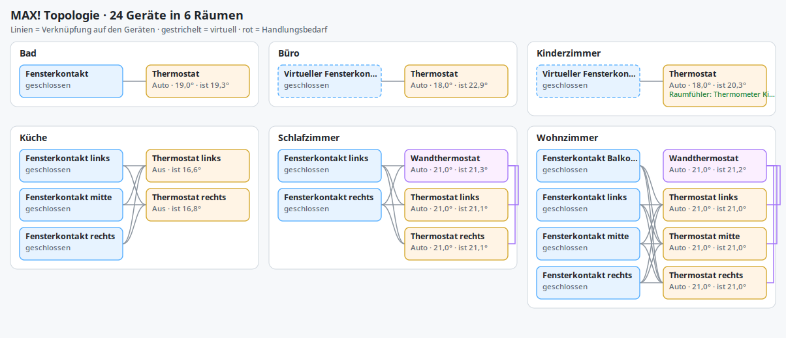
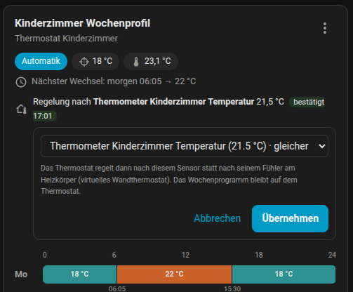
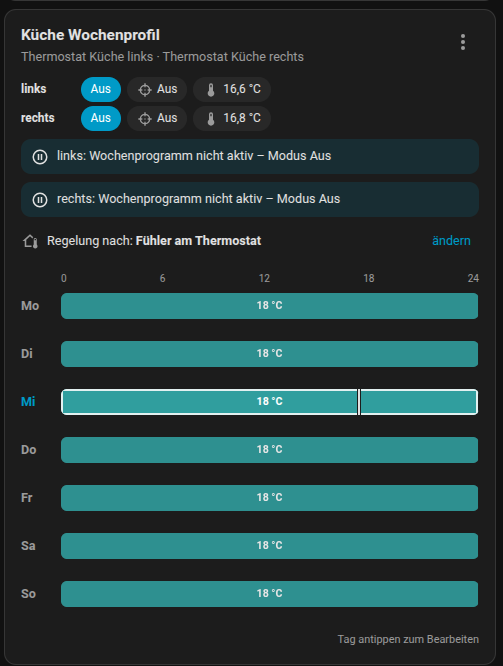
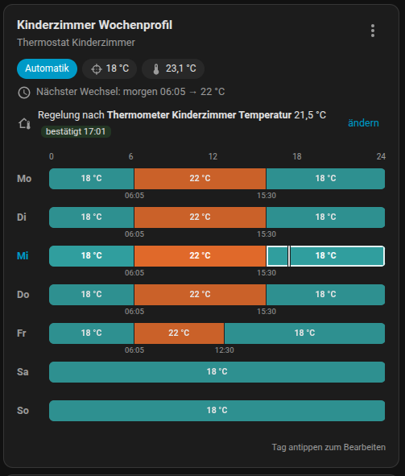
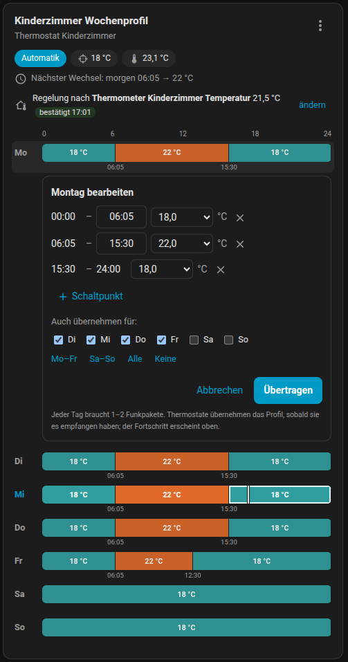

# MAX! via CUL

[English](README.en.md) | [Deutsch](README.md)

A Home Assistant custom integration for eQ-3 MAX! devices connected to a CUL
or CUNO running CULFW. For installation through HACS or manual installation,
see the [repository README](../../README.md).

The integration communicates directly with the CUL over TCP. It provides
both temperature control and direct associations between MAX! devices.
Window contacts, wall thermostats and radiator thermostats can therefore
continue cooperating while Home Assistant is offline. External sensors mapped
through Home Assistant to virtual contacts still require Home Assistant.

New to MAX! in Home Assistant? Start with the
[quick start and the recommended dashboard](../../README.md#quick-start) in
the main README.

## Features

- Pair MAX! devices directly from Home Assistant.
- Control radiator and wall thermostats.
- Edit weekly schedules using a draft, save and discard workflow.
- Write group IDs and link partners directly to devices.
- Create virtual MAX! window contacts for external sensors, including Zigbee,
  Matter and IKEA devices.
- Monitor last contact, stale states, acknowledgements, retries and pending
  configuration.
- Export and import the known MAX! topology as JSON.
- Vacation mode for the whole flat with automatic return to the week program.

## Architecture

The integration uses CULFW's MAX!/MORITZ mode over TCP. It is designed for
local operation with existing MAX! hardware, useful diagnostics and room
control performed by the devices themselves.

Its main components are:

- A serial command queue for write operations.
- Acknowledgement-based retries for configuration and control commands.
- A prioritized queue: interactive commands (target temperature, mode) overtake
  background traffic such as time synchronization.
- The CUL's send credit (1 % duty cycle) is read from culfw with `X` instead of
  being estimated; `LOVF` is detected and the packet resent. Firmware with a
  larger budget is picked up automatically.
- State carried in ACKs (mode, valve, target) is applied. Climate entities show
  a new target immediately and report via `command_status`
  (`sending`/`confirmed`/`failed`) whether the device confirmed it; on failure
  they fall back to the confirmed value.
- culfw auto-ACK (`Za<own address>`, like FHEM): telegrams from window
  contacts and wall thermostats addressed to the central are acknowledged at
  once, and wall-thermostat changes are applied immediately.
- Pending configuration delivery for sleeping window contacts, following
  patterns from FHEM and Homegear.
- Persistent storage of known devices and their topology.
- Direct device associations.
- No routine wake-up polling, to limit battery consumption and radio traffic.

## Supported Devices

- MAX! radiator thermostats
- MAX! radiator thermostat+
- MAX! wall thermostats
- MAX! window contacts (shutter contacts)
- Virtual MAX! window contacts created by this integration

## Setup

You need a CUL/CUNO running CULFW with MAX!/MORITZ support (a MAX! Cube
flashed with a-culfw works too) and the `cul_max` custom integration installed
in Home Assistant 2026.11 or newer.

The configuration flow first asks how the CUL is connected:

- **Network:** host name or IP address and TCP port (typically `2323`).
- **USB stick / serial:** the serial device (prefer the stable name below
  `/dev/serial/by-id/`) and baud rate (38400 for a CUL); setup checks that a
  CULFW answers. If Home Assistant OS runs in a VM (e.g. Proxmox), pass the
  stick through to the VM and **reboot the VM from the virtualization
  platform** (e.g. Proxmox) so it shows up below `/dev/serial/by-id/` –
  rebooting from within Home Assistant is not enough. Tested with a busware CUL868 (original CULFW 1.58,
  also via Proxmox USB passthrough).

It also asks for the integration's own MAX! radio address (default `123456`).

**Several CULs:** add each CUL as its own entry; setup proposes a free MAX!
address. Every CUL keeps its own device list. Services are routed to the CUL
that owns the device. Services without a device (`start_pairing`, `sync_time`,
`export_topology` …) take a `gateway` field, and every CUL device page has a
"Pairing" switch (on = pairing window open, off = stop early). Time sync,
wake-up and vacation without a gateway apply to all CULs.

Several CULs (e.g. several Cubes with a-culfw in a large house) work side by
side, not as repeaters: each CUL controls the devices it paired, so best the
ones within its radio range. Keep the devices of one room (thermostats, wall
thermostat, window contacts) on the same CUL, because links and groups are set
up within one CUL.

**Removing a device:** choose "Delete device" on the MAX! device page. Reset
the device first if it will be used with another central.

When replacing an existing MAX! setup, consider reusing the old Cube's radio
identity or resetting and pairing the devices again. Devices remember their
paired controller. Do not run two controllers with the same radio identity
at the same time.

## Reset and Pairing

Before pairing any device:

1. Open the pairing window – easiest with the [pairing card](#pairing-card),
   otherwise with the "Pairing" switch on the CUL device page or
   `cul_max.start_pairing`.
2. Put the device into pairing mode.

The card lists every device found right away and lets you set name, area and
room links in one step.

These procedures are a practical reference for common MAX! models. Wall
thermostat behaviour can vary by firmware version.

### Radiator thermostat

To reset:

1. Remove the battery.
2. Hold all three buttons simultaneously.
3. Reinsert the battery while holding the buttons.
4. Wait until `res` appears on the display.

To pair:

1. Start pairing in Home Assistant.
2. Hold the thermostat's Boost button for approximately three seconds.
3. The display counts down from `30` to `0`.
4. The thermostat should pair during this countdown.

### Window contact

To reset:

1. Remove the battery.
2. Hold the button.
3. Reinsert the battery while holding the button.
4. Keep holding it while the LED lights continuously.
5. Release the button when the LED starts blinking.

To pair:

1. Start pairing in Home Assistant.
2. Hold the contact's button for approximately three seconds.
3. The LED starts blinking and the contact should pair.

### Still paired with another controller

A MAX! device knows exactly one controller. If it was paired with a MAX! Cube
and never reset, it keeps reporting there, ignores configuration from Home
Assistant and repeats every message because the old controller does not
answer. Linked thermostats often still react, so this is easy to miss. Pairing
again without a reset is not enough: the device then asks its old controller.

The integration detects telegrams from a known device to an unknown address
when the device has not reported to this controller for two days. It then
raises a repair issue ("… is still paired with another controller"), sets
`Pairing State` to `paired_elsewhere` (climate attribute
`paired_elsewhere_central` names the address) and the week profile card shows
a notice. Fix: factory reset the device and pair it again; its name, links and
stored data are kept. The notice disappears once the device reports here.

### Wall thermostat

To reset:

1. Remove both batteries and wait for a while.
2. Hold the Moon, Boost/OK and Minus buttons simultaneously.
3. Reinsert the batteries while holding the buttons.
4. A version number briefly appears, followed by `res`.

Some devices require several attempts. On some firmware versions, holding
`Mode/Menu` opens a menu where you can select `res` directly.

To pair:

1. Start pairing in Home Assistant.
2. Put the wall thermostat into pairing mode.
3. After a reset, you may need to set its time once.
4. Following successful pairing, the integration normally sends the time
   and other basic configuration automatically.

## Device pages and topology

- Every MAX! device is "connected via" the *MAX! CUL* device, whose page lists
  all devices with their area.
- All entities have translated names (German/English); entity IDs are kept.
- Comfort, eco and window-open values apply automatically after 5 seconds; no
  save button needed.
- The former per-day text editors and the save/discard buttons are disabled by
  default (the week profile card replaces them); existing installations
  disable them once and they can be re-enabled in the entity settings.
- *Download diagnostics* is available for the integration and each device.

### Topology picture

The *MAX! CUL* device has an image entity **Topology**: all rooms (Home
Assistant areas) with wall thermostats, radiator thermostats and window
contacts. Lines show the links stored on the devices, dashed frames virtual
devices, green an external room sensor. Red marks things to act on: links into
another room (often a wrong area), "paired with another controller", no
contact, low battery or pending configuration. Virtual devices without an area
are shown in the room of their linked thermostat. Use the image in dashboards
like any other image entity.



## Vacation mode

For time away the integration uses the MAX! thermostats' built-in vacation
mode: every thermostat receives the vacation temperature together with an end
time, holds that temperature and returns to its week program **on its own** at
the end time. This works even if Home Assistant or the CUL is down during the
vacation.

The CUL device provides:

| Entity | Meaning |
| --- | --- |
| Vacation mode (switch) | On = all paired thermostats and wall thermostats go on vacation, off = return early |
| Vacation: temperature | Temperature while away, default 16 °C |
| Vacation: return date and return time | Day and time of your return (default time 18:00) |
| Vacation: preheat | Thermostats return to their program this many hours earlier |

Behaviour:

- MAX! only supports full and half hours for the end time; it is rounded down
  to :00 or :30 (after subtracting the preheat time).
- Every thermostat acknowledges the command. The switch attributes show
  `confirmed`, `pending` or `failed` per device; unconfirmed devices are
  retried automatically. Wall thermostats are set first so they do not
  override their rooms with the week program.
- The integration remembers the state before the vacation. Thermostats that
  were in manual mode (or off) are set back to it afterwards; all others simply
  continue with their week program.
- Switch off = early return: all thermostats go back immediately.
- Changing the temperature or return time during a vacation re-sends it (e.g.
  to extend the vacation).
- Window contacts and external room sensors keep working during the vacation.
- The week profile card shows "Urlaub bis …" (vacation until …).

The easiest way is the bundled card (registered as a resource
automatically):

```yaml
type: custom:cul-max-vacation-card
```

Normally it shows return date and time, temperature and preheat with a "start
vacation" button for the whole flat. During a vacation it shows the return
time, temperature, when the thermostats go back to their program and how many
confirmed, plus "change" and "end vacation".

For automations or single rooms use `cul_max.start_vacation` (optional
`temperature`, `end`, `preheat_hours`, `entity_ids`, `areas`) and
`cul_max.end_vacation`:

```yaml
action: cul_max.start_vacation
data:
  temperature: 16
  end: "2026-12-27 18:00"
  preheat_hours: 2
```

With the standard send budget a whole flat takes one to two minutes; the
queue spreads the commands automatically.

## Entities

### Thermostats

Radiator and wall thermostats expose:

- A `climate` entity for target temperature and HVAC mode.
- A "Valve opening" sensor in % (radiator thermostats only, with history).
- A "Measured temperature" sensor, e.g. as the temperature sensor of an area.
- `text` entities for weekly schedules.
- `number` entities for comfort, eco and window-open temperatures,
  window-open duration and measurement offset.
- `Save Configuration` and `Discard Draft` buttons.
- An optional custom Lovelace card for weekly schedules.

Temperature changes preserve the current MAX! mode where possible. Changing
the target temperature in `auto` mode does not immediately force the device
into `manual` mode. The climate attributes `mode_detail` and
`mode_is_temporary` help distinguish normal weekly operation from temporary
overrides.

Feedback and display:

- A new target or mode is shown immediately. The `command_status` attribute
  reads `sending`, then `confirmed` once the device acknowledged it. The shown
  values then come from the thermostat's ACK (mode, valve, target), i.e. the
  real device state.
- If no acknowledgement arrives, `command_status` becomes `failed`,
  `command_error` gives the reason, the entity falls back to the last confirmed
  values and Home Assistant reports an error. `command_requested` describes the
  last command sent.
- `manual` at 4.5 °C is shown as HVAC mode `off`. Switching from `off` to
  `heat` uses the comfort temperature.
- Presets: `eco` and `comfort` set the thermostat to manual at its eco or
  comfort temperature (handy for schedulers that can only switch presets),
  `boost` starts boost, `none` returns to the weekly program. A thermostat in
  manual at exactly its eco or comfort temperature shows that preset.
- Changes made on a wall thermostat (knob, mode button) are applied directly
  from its `SetTemperature` telegram.

Changes to the schedule and configuration entities are stored as drafts.
Press **Save Configuration** to send them to the device, or **Discard Draft**
to abandon the edits. Direct service calls provide another way to configure
devices.

### External room sensor (virtual wall thermostat)

A radiator thermostat behind a curtain or close to the hot radiator measures
too high and regulates poorly. Instead of an offset it can regulate on any
temperature sensor in Home Assistant. This is **per thermostat and off by
default**.



Enable it in the week profile card ("Regelung nach" → *ändern* → choose a
sensor; sensors in the same area are listed first) or with the service:

```yaml
action: cul_max.set_external_temperature_sensor
data:
  entity_id: climate.kids_room
  sensor_entity_id: sensor.kids_room_temperature  # empty = own sensor
```

Every room sensor gets its own virtual wall thermostat (thermostats with the
same sensor share one; the first is own address + 1, e.g. `123457`, further
ones get addresses from `A00000`), because a thermostat takes over every
telegram of its wall thermostat, even one addressed to another thermostat. Only
telegrams to the first one are acknowledged by the CUL itself; turning the knob
of a thermostat in another room makes it repeat its message a few times
(harmless). The integration links the thermostat with its virtual wall thermostat and sends `WallThermostatControl` with current and
target temperature like a real wall thermostat, on changes of 0.5 K or more (at most
every 3 min, 5 min with the standard send budget – every message wakes the
thermostat), on a new target and periodically (every 8 min with an extended send budget, 20 min
otherwise); each message must be acknowledged. The week program stays on the
thermostat: the target sent is the profile value unless it was changed (Home
Assistant or the knob) after the current profile segment began; the window-open
temperature is never sent as target. If the sensor is unavailable or its value
is older than 8 hours nothing is sent and the thermostat falls back to its own
sensor (many sensors, e.g. Zigbee thermometers, only report on change, so the
last value stays valid while the room temperature is steady). The
climate entity exposes `external_temperature_sensor`, `external_temperature`,
`external_temperature_status` and the last confirmation time. Radiator
thermostats only; use it where needed, it costs radio budget.

### Window contacts

Physical and virtual MAX! contacts expose a `binary_sensor` for their
open/closed state.

### Diagnostics

Depending on device type, diagnostic entities include:

- `Last Seen`, `Last Ack` and `Last Command Success`
- `Last Time Sync`
- `Expected Week Profile Temperature` and `Week Profile Validation`
- `Retry Count` and communication status
- `Stale`, indicating that a device has not been heard from for too long
- `Config Pending`, indicating undelivered configuration
- `Pairing State`

An integration-wide `Pairing Mode` binary sensor indicates whether the pairing
window is open. Its attributes include `pairing_until` and `remaining_seconds`.
The exact entity ID may vary; search for the integration's `Pairing Mode`
entity in Home Assistant.

Critical states also appear in device model labels, for example
`MAX! ShutterContact · discovered` or
`MAX! HeatingThermostat · pending config`.

Diagnostic attributes include:

| Area | Attributes |
| --- | --- |
| Associations | `group_id`, `linked_partners`, `peer_names`, `peer_labels`, `supported_partner_types` |
| Pairing | `is_paired`, `pairing_state` |
| Configuration | `pending_config`, `config_pending`, `last_command` |
| Time | `last_time_sync_at`, `last_reported_time` |
| Schedule | `expected_week_profile_temperature`, `week_profile_validation`, `week_profile_validation_reason`, `actual_target_temperature`, `temperature_delta_to_expected` |
| Window state | `window_open_active`, `open_window_partners`, `open_window_partner_names` |
| Pending queue | `pending_queue_type`, `pending_queue_length`, `pending_queue_current`, `pending_queue_attempts`, `pending_queue_last_error`, `pending_queue_next_attempt_at` |

Queue metadata shows the current step, retry attempts and next scheduled
attempt. Climate configuration queues continue processing in the background
when the initial attempt did not complete.

### Weekly schedule validation

`Week Profile Validation` is a best-effort diagnostic, not a readback of the
schedule stored on the device. It compares the known schedule with the current
target temperature, mode, window state and pending configuration.

| State | Meaning |
| --- | --- |
| `likely_applied` | The target temperature matches the expected schedule. |
| `pending` | Schedule or other climate configuration has not finished delivery. |
| `window_open` | An associated window contact is open. |
| `manual_override`, `temporary_override`, `boost` | The device is currently operating outside its normal weekly schedule. |
| `mismatch` | The expected and actual target temperatures differ. |
| `unknown` | There is not enough information to assess the schedule. |

Pairing states have these meanings:

- `paired`: Paired through this integration's pairing process.
- `discovered`: Seen over radio but not yet paired through this integration;
  common after migration from a Cube or another controller.
- `virtual`: A virtual device created by the integration.

## Services

Services are available in Home Assistant. See [services.yaml](services.yaml)
for their complete field definitions. Many operational services return a
response directly in Developer Tools, including topology import, room
association, time synchronisation and cleanup dry runs.

| Purpose | Services in the `cul_max` domain |
| --- | --- |
| Pairing and naming | `start_pairing`, `set_device_name` |
| Temperature and schedules | `set_temperature_config`, `set_desired_temperature`, `set_week_profile`, `set_week_profile_days` |
| Vacation | `start_vacation`, `end_vacation` |
| Time and wake-up | `sync_time`, `wake_thermostats` |
| Device associations | `set_group_id`, `remove_group_id`, `add_link_partner`, `remove_link_partner`, `associate_devices`, `deassociate_devices` |
| Virtual contacts | `create_virtual_shutter_contact`, `delete_virtual_device`, `send_virtual_shutter_contact_state` |
| Rooms | `create_room_association`, `delete_room_association`, `rebuild_room_association` |
| Backup and cleanup | `export_topology`, `import_topology`, `cleanup_superseded_devices` |

For everyday room setup, use the room services. The lower-level group and
link services are useful for migration, repairs and debugging.

`set_desired_temperature` supports explicit MAX! modes such as `auto`,
`manual`, `boost` and temporary settings ending at an `until` time. This is
useful when investigating the difference between a weekly schedule and a
temporary override.

`wake_thermostats` is intended for occasional manual use. Frequent wake-up
commands increase battery consumption and radio traffic.

## Examples

Replace example entity IDs and device names with those from your installation.

### Start pairing from a phone

Easiest with the [pairing card](#pairing-card) or the "Pairing" switch on the
CUL device page (also usable as a dashboard tile). For automations or a
button of your own:

```yaml
type: button
name: MAX Pairing
icon: mdi:link-variant-plus
tap_action:
  action: perform-action
  perform_action: cul_max.start_pairing
  data:
    duration: 60
```

### Check and synchronise device clocks

Weekly schedules run on the devices. An incorrect device clock can make a
correct schedule appear shifted. Check `Last Time Sync` and
`last_reported_time` before changing the schedule.

Synchronise one thermostat:

```yaml
action: cul_max.sync_time
data:
  entity_id: climate.bedroom_thermostat
```

Synchronise all paired radiator and wall thermostats:

```yaml
action: cul_max.sync_time
data: {}
```

The integration already attempts time synchronisation after pairing. It also
assigns climate devices to 12 hourly time slots for periodic background clock
updates. An explicit sync is still useful after migration or when schedule
behaviour looks wrong.

### Configure comfort, eco and window-open settings

These are actual device configuration values, also known in FHEM and
Homegear as `comfortTemperature`, `ecoTemperature`, `windowOpenTemperature`
and `windowOpenDuration`.

```yaml
action: cul_max.set_temperature_config
data:
  entity_id: climate.bathroom_thermostat
  comfort_temperature: 21.0
  eco_temperature: 17.0
  window_open_temperature: 12.0
  window_open_duration: 15
```

### Set a weekly schedule

Each line contains a day followed by alternating temperatures and end times.
The final temperature applies until midnight:

```yaml
action: cul_max.set_week_profile
data:
  entity_id: climate.bathroom_thermostat
  profile: "Mon 18,07:05,23,15:30,18"
```

This means 18 °C until 07:05, 23 °C until 15:30 and 18 °C until midnight.
Times must use five-minute steps and increase strictly. Each day supports
up to 13 temperature segments. Empty fields, duplicate days and intermediate
`24:00` transitions are rejected; midnight is implied by the final temperature.

Weekly schedules require multiple radio packets per day and can take longer
to deliver than individual temperature commands. `Config Pending` may remain
active while delivery proceeds. Radio traffic and transmission limits can
increase the time needed.

In a room with a wall thermostat, normally write the schedule to the wall
thermostat. MAX! distributes control to the associated radiator thermostats;
you generally do not need to write the same schedule to each radiator.

### Weekly schedule Lovelace card

MAX! devices cannot report their week program. If a program was set outside
Home Assistant (e.g. with the old Cube) the card shows those days as
"unbekannt" (unknown). Tapping a day still opens the editor (starting from the
eco/comfort temperatures); "Auch übernehmen für" sets several days at once.

**A bit warmer or cooler:** while all thermostats of the card run their week
program (auto), the card shows `−`/`+` (0.5 °C steps) below the chips. The
change lasts until the next switching point ("19,5 °C bis 22:00, danach 18 °C
laut Plan"); then the thermostat follows its program again by itself. Several
taps are collected into one command per thermostat; with several thermostats
in the card (e.g. a kitchen without wall thermostat) all of them change.
"Zurück zum Plan" undoes it right away. Disable with `quick_change: false`.

**Program from another room:** in the day editor, "Aus anderem Raum übernehmen
…" lists the other MAX! thermostats with a known program (by area). "this day
only" fills the editor so it can still be adjusted; "whole week" shows a
preview and then uploads all known days (identical days are skipped).

**Several thermostats in one card:** "⋮" opens a chooser; tapping a
thermostat's status row opens exactly that one.

In Lovelace storage mode, the integration registers its card resource
automatically and makes it available in the visual card editor.

```yaml
type: custom:cul-max-week-profile-card
entity: climate.bathroom_thermostat
title: Bathroom weekly schedule
```

Existing manual `/local/cul-max-week-profile-card.js` resource entries are
migrated to the embedded path in storage mode. In YAML mode, register
`/cul-max/cul-max-week-profile-card.js` manually as a `module` resource.
Reload the browser after initial registration or an update if necessary.

Options: `entity` or `entities`, `title`, `show_current_temp` (default `true`),
`editable` (default `true`) and `quick_change` (default `true`).

Several radiator thermostats in a room without a wall thermostat can share one
card:

```yaml
type: custom:cul-max-week-profile-card
title: Kitchen weekly schedule
entities:
  - climate.kitchen_left
  - climate.kitchen_right
```



Each thermostat gets a status line (the shared part of the names is dropped,
e.g. "left"/"right"). Days with identical profiles show one timeline; days that
differ are marked "≠" and show one timeline per thermostat. An edited day is
uploaded to all thermostats of the card, one after the other. The visual editor
offers "Weitere Thermostate im selben Raum" for this.



The card shows:

- A 24 h timeline per day, coloured by temperature (off grey, cool blue, eco
  teal, comfort orange to red), with switching times below.
- Today highlighted, a "now" marker and the active segment outlined.
- Mode, target, current temperature and valve position, plus the next
  switching point (e.g. `morgen 06:05 → 22 °C`).
- A notice when the weekly program is not active (manual, off, boost or
  vacation).
- Notices when a window is open, the thermostat deviates from the schedule, a
  schedule upload is still in progress (open packets and last error) or a
  command was not confirmed.

Editing:



- Tap a day to open the editor: change switching times (`hh:mm`, 5-minute
  steps) and temperatures (4.5–30.5 °C, 4.5 = off), add or remove points (at
  most 13 per day).
- Copy the day to other days (shortcuts Mon–Fri, Sat–Sun, all).
- "Übertragen" validates the input and sends only the affected days through
  `cul_max.set_week_profile_days`; errors are shown in the editor.
- Schedules inherited from a linked wall thermostat are read-only here; edit
  them on the wall thermostat.

The three-dot button opens the climate entity's more-info dialog (with several
thermostats a chooser first).

### Transmission queue card

```yaml
type: custom:cul-max-queue-card
```

Shows what is waiting for radio time: send budget and recovery per second,
estimated time until everything is out, the queued commands in plain words
and pending configuration per device. Single commands can be removed, pending
configuration of a device discarded. Read-only towards the radio.

### Pairing card

```yaml
type: custom:cul-max-pairing-card
```

Starts pairing (60 s, 2 or 5 min; gateway chooser with several CULs), shows a
countdown and lists every device that answered in this session – new or
already known – with a name suggested from type and area. Name, area and
optionally "link with the MAX! devices in the area" (group and links, for the
new device only) are saved in one step. Devices still belonging to another
central are listed with the hint to reset them.

### Set up a complete room

```yaml
action: cul_max.create_room_association
data:
  room_name: Kitchen
  climate_device_names:
    - Kitchen wall thermostat
    - Kitchen left radiator
    - Kitchen right radiator
  create_virtual_shutter_contact: true
  virtual_shutter_contact_name: Kitchen virtual window contact
  bidirectional: true
```

Room associations can take time to become fully effective, especially with
several contacts and thermostats. If you previously configured a specific
`group_id` manually, pass it explicitly when creating the room; otherwise a
different free group ID may be selected.

Open and close physical window contacts a few times to help deliver pending
configuration to sleeping devices. Check `Config Pending` and peer diagnostics.
Finish by testing window opening, closing and temperature changes on the
actual devices.

### Map an external sensor to a virtual MAX! contact

1. Create a virtual contact or choose an existing one.
2. Associate it with the target room.
3. Use an automation to forward the external sensor's state.

Associate an existing virtual contact at address `A00000`:

```yaml
action: cul_max.create_room_association
data:
  room_name: Office
  climate_entity_ids:
    - climate.office_thermostat
  window_addresses:
    - A00000
  bidirectional: true
```

Forward state changes:

```yaml
alias: Office external window contact to MAX
mode: single
trigger:
  - platform: state
    entity_id: binary_sensor.office_window
condition:
  - condition: template
    value_template: "{{ trigger.to_state is not none and trigger.to_state.state in ['on', 'off'] }}"
action:
  - action: cul_max.send_virtual_shutter_contact_state
    data:
      address: A00000
      is_open: "{{ trigger.to_state.state == 'on' }}"
```

Check that the contact's pairing state is `virtual`, that the thermostat and
contact list each other as peers, and that the thermostat reacts when the
external sensor opens and closes. Virtual contact transmissions receive
priority so they do not wait behind lengthy schedule configuration queues.

A virtual contact behaves like a real MAX! window contact:

- The state is sent directly to every linked thermostat (with that
  thermostat's group ID, like FHEM's `fakeSC`) and must be acknowledged by it;
  missing ACKs are retried. The ACK carries the thermostat's new state, so the
  climate entity shows at once whether it entered or left the window-open
  temperature.
- Quick open/close sequences are delivered in order, each one acknowledged.
- The current state is re-sent every 50 minutes (real contacts report hourly)
  and once about 2 minutes after startup, so a lost telegram cannot keep a
  thermostat at its window-open temperature. Unconfirmed deliveries are
  retried with growing intervals (60 s up to 50 min).
- The service returns `confirmed: true` when all linked thermostats
  acknowledged.
- Without a linked thermostat the state is broadcast once to the central, as
  before.

Common pitfalls:

- Use `create_virtual_shutter_contact: true` only when creating a new contact;
  an existing address causes an error.
- Add existing contacts through `window_addresses`, `window_entity_ids` or
  `window_device_names`.
- `virtual_shutter_contact_address` only applies together with
  `create_virtual_shutter_contact: true`.
- Writes to physical thermostats marked `discovered` rather than `paired`
  are blocked until pairing is completed.
- For problems, check peers, pairing state, pending configuration and
  communication diagnostics on all involved devices.

### Back up and restore the topology

Export:

```yaml
action: cul_max.export_topology
data:
  path: backups/cul_max_topology.json
```

Import:

```yaml
action: cul_max.import_topology
data:
  path: backups/cul_max_topology.json
  create_virtual_devices: true
  update_names: true
  apply_group_ids: true
  apply_links: true
  apply_week_profiles: true
```

### Clean up after migration

After migration, devices may initially appear as `discovered`, and old device
or entity registry entries may remain.

1. Reset and pair affected devices if necessary.
2. Check that their pairing state is `paired`.
3. Preview cleanup candidates before removing old entries.

Preview:

```yaml
action: cul_max.cleanup_superseded_devices
data:
  dry_run: true
```

The response lists candidates directly, without requiring more verbose global
logging.

Remove superseded devices and their registry entries:

```yaml
action: cul_max.cleanup_superseded_devices
data:
  dry_run: false
  remove_registry_entries: true
```

To also remove old devices that are only marked `discovered`, add
`remove_discovered_devices: true`. This expands the cleanup beyond superseded
devices, so review the candidates with that option in a dry run first.

## Export Format and Restore Behaviour

The JSON export includes known devices, addresses, types, display names,
group IDs, link partners, weekly schedules as hex and readable daily lines,
virtual contacts and the last known device state.

Import updates existing devices and can create missing virtual contacts. It
can restore groups, links and schedules, but does not automatically create
unknown physical devices or remove additional existing links. It restores the
known topology rather than performing an exact replacement of all state.

## Reliable Operation

- Sleeping devices may need to wake before configuration can be delivered.
- Window contacts can apply changes later; monitor `Config Pending`.
- Allow time for weekly schedules and room associations to complete.
- Test physical window contacts and temperature changes after major room changes.
- Do not operate two controllers with the same radio identity simultaneously.
- Let the serial command queue handle batches of writes.
- Monitor `Last Seen`, `Stale` and communication diagnostics.

### Radio budget and send order

- The CUL may only transmit 1 % of the time (`credit_10ms`, max. 900 = 9 s on
  a-culfw, +1 per second). Every packet to a sleeping thermostat needs a 1 s
  wake-up preamble and costs about 113 units. The integration reads the real
  value from culfw with `X`, waits when needed and resends after `LOVF`.
  Firmware with a larger budget is detected automatically.
- Commands are prioritized: target temperature and mode before configuration,
  both before time synchronization. Background traffic always leaves enough
  budget for one interactive command.
- Time synchronization sends one packet and waits for its ACK instead of
  blindly repeating several packets.
- On connect, culfw auto-ACK (`Za<own address>`) is enabled, so the CUL
  immediately acknowledges telegrams from window contacts and wall thermostats
  to the central and the devices do not repeat them.
- Other programs connected to the same CUL at the same time (for example FHEM
  or ioBroker) share this budget.

### Increased send budget (modified firmware)

> **Legal notice:** MAX! transmits on 868.3 MHz in an SRD band where a device
> may transmit at most 1 % of the time (EU rules for short range devices,
> ETSI EN 300 220; in Germany the general assignment by the Bundesnetzagentur).
> The limit applies throughout the EU, not only in Germany.
> A CULFW that allows more airtime does not respect this limit. Operating it is
> **not legal** and can disturb other radio users. The integration does not
> modify firmware, unlocks nothing and never sends more than the firmware
> itself permits.

The integration adapts to the budget reported by the CUL:

| Profile | Active when | Behaviour |
|---|---|---|
| `standard` | up to 1350 `credit_10ms` and recovery up to 1.5/s (stock a-culfw: 900, 1/s) | SetTemperature: 5 s ACK timeout, 4 retries; reserve for 1 interactive packet |
| `extended` | clearly larger budget or faster recovery | SetTemperature: 3 s ACK timeout, 6 retries; configuration and weekly schedule 2 more retries each; pending configuration retried after 10 s instead of 30 s (max. 120 s instead of 300 s); faster startup time sync; reserve for one interactive command including all retries |

The budget is queried with `X` on connect, when needed and every 5 minutes
(this does not use the radio). From consecutive values the integration
measures how fast the CUL regains budget. The diagnostic sensor `Send Budget`
on the `MAX! CUL` device shows the current credit and, as attributes, the
maximum, recovery rate, active profile and queue length.

The extended profile mainly speeds up recovery from lost packets. Each packet
to a sleeping thermostat still needs its 1 s wake-up preamble, so weekly
schedules are not transferred much faster.

MAX! radio messages can be missed or acknowledged late. Initial setup,
pairing and bulk configuration may therefore take longer than expected.
Hardware tests depend on the specific CULFW firmware and device behaviour.

## Tests

Protocol regression tests are in [tests/test_protocol.py](tests/test_protocol.py).
Run them from the repository root:

```sh
python3 -m unittest discover -s custom_components/cul_max/tests -v
```

Coverage includes FHEM-compatible weekly schedule encoding, packet splitting,
byte-level temperature, wake-up and contact commands, parser validation,
formatting round trips, exact schedule boundaries and local time zones that
differ from the host's time zone.

## License and Acknowledgements

See [LICENSE](LICENSE) for the project's GNU General Public License, version 3.

This integration builds on the extensive protocol knowledge and practical
experience of FHEM and Homegear. Special thanks to the FHEM `10_MAX.pm` and
`14_CUL_MAX.pm` modules for message construction, schedules, time handling
and association logic, and to Homegear for its peer, queue and pending
configuration model.

The reference files include these author and copyright notices:

- FHEM `10_MAX.pm` and `14_CUL_MAX.pm`: Matthias Gehre and Wzut; GNU General
  Public License, version 2 or later.
- Homegear `MAXCentral.cpp` and `MAXPeer.cpp`: Copyright 2013–2019 Homegear
  GmbH; GNU General Public License, version 3 or later, with a documented
  OpenSSL linking exception.

## Documentation Link in Home Assistant

Home Assistant uses the `documentation` field in [manifest.json](manifest.json)
to link to this integration's documentation. It currently points to the
[English repository README](https://github.com/thnow/MAX-via-Cul/blob/main/README.md).
