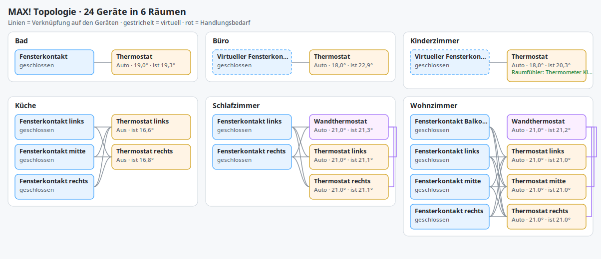
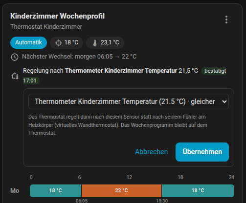
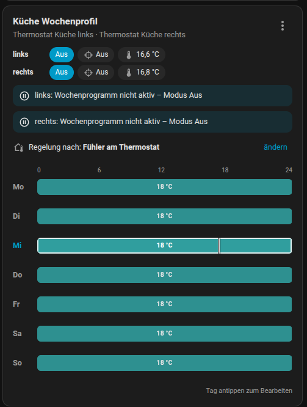
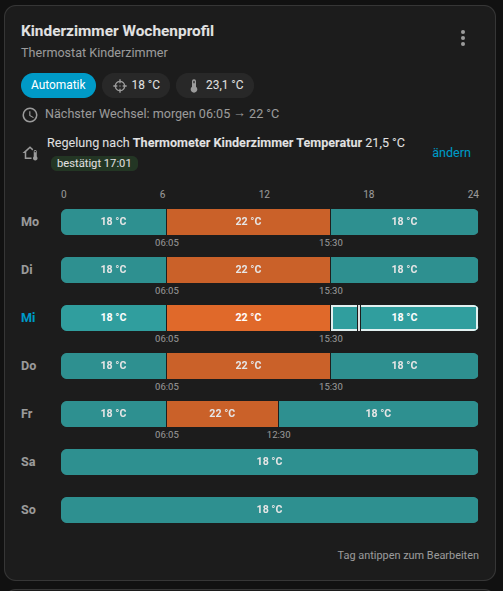
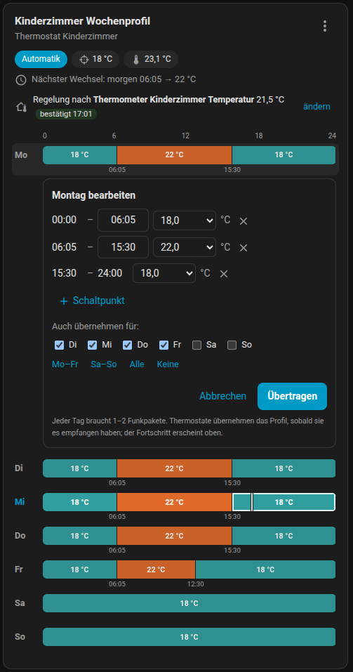

# MAX! via CUL

[English](README.en.md) | [Deutsch](README.md)

Home-Assistant-Custom-Integration fuer eQ-3 MAX!-Komponenten an einem mit
CULFW geflashten CUL oder CUNO.

Die Integration spricht direkt mit dem CUL per TCP und bildet nicht nur die
Grundfunktionen eines MAX! Cubes nach, sondern auch echte On-Device-
Assoziationen zwischen MAX!-Geraeten. Dadurch koennen Fensterkontakte,
Wandthermostate und Heizkoerperthermostate auch ohne laufenden Home Assistant
weiter sinnvoll zusammenarbeiten.

## Highlights

- Pairing neuer MAX!-Geraete direkt aus Home Assistant
- Temperatursteuerung fuer Heizkoerper- und Wandthermostate
- Wochenprofile mit Entwurfs-/Speicher-Workflow statt Sofort-Schreiben
- echte Gruppen-IDs und Link-Partner auf Geraeteebene
- virtuelle MAX!-Fensterkontakte fuer externe Sensorquellen wie Zigbee, Matter oder IKEA
- Diagnose-Entitaeten fuer `last_seen`, `stale`, `last_ack`, Retries und Kommunikationsstatus
- JSON-Export und -Import der bekannten MAX!-Topologie
- Urlaubsmodus fuer die ganze Wohnung mit automatischer Rueckkehr zum Wochenprogramm

## Zielbild

Die Integration ist auf einen robusten Alltagseinsatz mit alter, aber
weiterhin sehr brauchbarer MAX!-Hardware ausgelegt. Der Schwerpunkt liegt auf
lokaler Kommunikation, nachvollziehbarer Diagnose und moeglichst viel Logik
direkt auf den Geraeten statt ausschliesslich in Home Assistant.

## Architektur

Die Integration verbindet sich per TCP mit dem CUL und nutzt den MAX!/MORITZ-Modus des CULFW.

Wichtige Eigenschaften:

- lokale Kommunikation ohne Cloud
- zentrale serielle Command-Queue fuer Schreiboperationen
- ACK-basierte Wiederholungen bei Konfigurations- und Steuerbefehlen
- priorisierte Queue: interaktive Befehle (Solltemperatur, Modus) ueberholen
  Hintergrundverkehr wie Zeitsynchronisation
- Sendekredit (1 %-Duty-Cycle) wird per `X` direkt vom CULFW gelesen statt
  geschaetzt; `LOVF` wird erkannt und das Paket erneut gesendet. Firmware mit
  mehr Sendezeit wird automatisch erkannt
- die Statusdaten in ACKs (Modus, Ventil, Solltemperatur) werden ausgewertet;
  die Climate-Entitaet zeigt einen Sollwert sofort an und meldet ueber
  `command_status` (`sending`/`confirmed`/`failed`), ob das Geraet ihn
  bestaetigt hat. Bei Fehlschlag wird auf den bestaetigten Wert zurueckgesetzt
- Auto-ACK im CULFW (`Za<eigene Adresse>`, wie FHEM): an die Zentrale
  adressierte Telegramme von Fensterkontakten und Wandthermostaten werden
  sofort bestaetigt; Aenderungen am Wandthermostat werden direkt uebernommen
- Pending-Config-Zustellung fuer schlafende MAX!-Fensterkontakte nach FHEM-/Homegear-Muster
- Persistenz aller bekannten Geraete und ihrer wichtigsten Topologie-Daten
- echte On-Device-Assoziationen statt reiner HA-in-the-loop-Automation
- kein automatisches WakeUp-Polling im Normalbetrieb, um Batterieverbrauch und
  Funklast niedrig zu halten

## Unterstuetzte Geraete

Aktuell ausgelegt fuer:

- MAX! Heizkoerperthermostate
- MAX! Heizkoerperthermostat+
- MAX! Wandthermostate
- MAX! Fensterkontakte
- virtuelle MAX!-Fensterkontakte innerhalb dieser Integration

## Einrichtung

### Voraussetzungen

- ein mit CULFW geflashter CUL/CUNO (auch ein MAX! Cube mit a-culfw)
- Anbindung per TCP (typischerweise Port `2323`) oder als USB-Stick
  (z. B. CUL, nanoCUL, meist 38400 Baud)
- Home Assistant 2026.11 oder neuer mit installiertem Custom Component `cul_max`

### Konfiguration

Die Integration wird ueber den Config Flow eingerichtet.

Zuerst waehlt man die Anbindung:

- **Netzwerk:** Hostname oder IP-Adresse und TCP-Port des CUL
- **USB-Stick / seriell:** serielles Geraet (am besten der stabile Name unter
  `/dev/serial/by-id/`) und Baudrate; die Einrichtung prueft, ob ein CULFW
  antwortet

Dazu kommt die eigene MAX!-Adresse der Integration.

**Mehrere CULs:** Jeder CUL wird als eigener Eintrag eingerichtet (eigene
MAX!-Adresse waehlen). Dienste gehen automatisch an den CUL, zu dem das
Geraet gehoert. Dienste ohne Geraetebezug (`start_pairing`, `sync_time`,
`export_topology` …) haben das Feld `gateway`; zum Anlernen gibt es ausserdem
auf jeder CUL-Geraeteseite den Button „Anlernen starten“. Zeit-Sync, Wecken
und Urlaub ohne Gateway-Angabe gelten fuer alle CULs.

Hinweis:
Wenn ein bestehendes MAX!-Setup ersetzt wird, kann es sinnvoll sein, die Funk-Identitaet des alten Cubes sauber zu uebernehmen oder die Komponenten neu zu koppeln.

## Reset und Anlernen

Die folgenden Schritte sind als praxiserprobte Kurzreferenz fuer typische
MAX!-Geraete gedacht.

Vor dem Anlernen in Home Assistant:

1. `cul_max.start_pairing` aufrufen
2. danach das jeweilige Geraet in den Anlernmodus bringen

Wenn alles korrekt laeuft, sollte das Pairing in der Regel schnell
abgeschlossen sein.

### Heizkoerperthermostat

Reset:

1. Batterie entfernen.
2. Alle drei Tasten gleichzeitig gedrueckt halten.
3. Batterie wieder einsetzen.
4. Warten, bis im Display `res` erscheint.

Anlernen:

1. In Home Assistant das Pairing starten.
2. Am Thermostat die Boost-Taste fuer etwa 3 Sekunden gedrueckt halten.
3. Im Display erscheint ein Countdown von `30` nach `0`.
4. Das Geraet sollte waehrenddessen schnell angelernt werden.

### Fensterkontakt

Reset:

1. Batterie entfernen.
2. Taste gedrueckt halten.
3. Batterie wieder einsetzen.
4. Die Taste weiter gedrueckt halten. Zunaechst leuchtet die LED dauerhaft.
5. Taste erst loslassen, wenn der Sensor zu blinken beginnt.

Anlernen:

1. In Home Assistant das Pairing starten.
2. Die Taste am Fensterkontakt fuer etwa 3 Sekunden gedrueckt halten.
3. Die LED beginnt zu blinken.
4. Das Geraet sollte dann angelernt werden.

### Noch an einer anderen Zentrale angemeldet

Ein MAX!-Geraet kennt genau eine Zentrale. Wurde es frueher an einem MAX! Cube
angelernt und nicht zurueckgesetzt, meldet es sich weiter dort. Es nimmt dann
keine Konfiguration von Home Assistant an und wiederholt jede Meldung, weil die
alte Zentrale nicht antwortet. Verknuepfte Thermostate reagieren oft trotzdem,
deshalb faellt das im Alltag kaum auf. Ein erneutes Anlernen ohne Reset reicht
nicht: das Geraet fragt dann gezielt seine alte Zentrale.

Die Integration erkennt das an Telegrammen eines bekannten Geraets an eine
unbekannte Adresse, wenn es sich seit zwei Tagen nicht bei dieser Zentrale
gemeldet hat. Dann:

- erscheint unter Einstellungen → Reparaturen der Hinweis „… ist noch an einer
  anderen Zentrale angemeldet“ mit der fremden Adresse,
- zeigt `Pairing State` den Wert `paired_elsewhere` (Climate-Attribut
  `paired_elsewhere_central` nennt die Adresse),
- zeigt die Wochenprogramm-Karte einen Hinweis.

Abhilfe: Geraet zuruecksetzen (siehe oben) und neu anlernen. Name, Verknuepfungen
und gespeicherte Daten bleiben beim erneuten Anlernen in Home Assistant
erhalten. Der Hinweis verschwindet, sobald sich das Geraet bei dieser Zentrale
meldet.

### Wandthermostat

Reset:

1. Beide Batterien entfernen.
2. Wirklich einige Zeit warten.
3. `Mond`, `Boost/OK` und `Minus` gleichzeitig gedrueckt halten.
4. Batterien wieder einsetzen.
5. Zuerst erscheint kurz eine Versionsanzeige, danach `res` im Display.

Hinweise:

- Beim Wandthermostat braucht man fuer den Reset je nach Softwareversion und
  Geraet manchmal mehrere Versuche.
- Bei manchen Versionen kommt man auch ueber einen langen Druck auf
  `Mode/Menu` ins Menue und kann dort `res` direkt auswaehlen.

Anlernen:

1. In Home Assistant das Pairing starten.
2. Das Wandthermostat in den Anlernmodus bringen.
3. Nach dem Reset muss am Wandthermostat gelegentlich einmalig die Uhrzeit
   gesetzt werden.
4. In der Regel bekommt das Geraet Uhrzeit und weitere Basisdaten nach dem
   erfolgreichen Pairing aber auch automatisch vom Cube bzw. von der
   Integration.

## Geraeteseiten und Topologie

- Jedes MAX!-Geraet ist in Home Assistant „verbunden ueber“ das Geraet
  *MAX! CUL*; dessen Seite listet alle Geraete mit Raum auf.
- Alle Entitaeten haben deutsche bzw. englische Namen (je nach Sprache von
  Home Assistant); die Entity-IDs bleiben unveraendert.
- Komfort-, Absenk- und Fenster-offen-Werte werden nach kurzer Pause (5 s)
  automatisch uebertragen, ohne Speichern-Knopf.
- Die frueheren Text-Editoren pro Wochentag sowie „Konfiguration
  uebertragen“/„Entwurf verwerfen“ sind standardmaessig deaktiviert (die
  Wochenprogramm-Karte ersetzt sie). Bestehende Installationen deaktivieren sie
  einmalig; sie lassen sich in den Entitaetseinstellungen wieder aktivieren.
- *Diagnosedaten herunterladen* gibt es fuer die Integration und jedes Geraet
  (Topologie, Sendebudget, Warteschlangen, Status).

### Topologie-Bild

Das Geraet *MAX! CUL* hat eine Bild-Entitaet **Topologie**: eine Uebersicht
aller Raeume (Home-Assistant-Bereiche) mit Wandthermostaten, Heizkoerper-
thermostaten und Fensterkontakten. Linien zeigen die Verknuepfungen auf den
Geraeten, gestrichelte Rahmen virtuelle Geraete, gruen einen externen
Raumfuehler. Rot markiert Handlungsbedarf: Verknuepfungen in einen anderen
Raum (oft ein falsch zugeordneter Bereich), „an anderer Zentrale angemeldet“,
keine Meldung, schwache Batterie oder ausstehende Konfiguration. Virtuelle
Geraete ohne Bereich erscheinen im Raum ihres verknuepften Thermostats. Das
Bild laesst sich wie jedes Bild in Dashboards verwenden (z. B. Bildkarte).



## Urlaubsmodus

Fuer Abwesenheiten nutzt die Integration den eingebauten Urlaubsmodus der
MAX!-Thermostate: Jedes Thermostat bekommt die Urlaubstemperatur zusammen mit
einem Endzeitpunkt, haelt diese Temperatur und kehrt zum Endzeitpunkt
**selbststaendig** zu seinem Wochenprogramm zurueck. Das funktioniert auch,
wenn Home Assistant oder der CUL waehrend des Urlaubs nicht laufen.

Am CUL-Geraet gibt es dafuer:

| Entitaet | Bedeutung |
| --- | --- |
| Urlaubsmodus (Schalter) | Ein = alle angemeldeten Thermostate und Wandthermostate in den Urlaub, Aus = vorzeitig zurueck |
| Urlaub: Temperatur | Temperatur waehrend der Abwesenheit, Standard 16 °C |
| Urlaub: Rueckkehr (Datum) und (Uhrzeit) | Tag und Uhrzeit der Rueckkehr (Standard-Uhrzeit 18:00) |
| Urlaub: Vorheizen | So viele Stunden vor der Rueckkehr gehen die Thermostate zurueck ins Programm |

Ablauf und Verhalten:

- MAX! kennt fuer das Ende nur volle und halbe Stunden; der Zeitpunkt wird
  (nach Abzug der Vorheizzeit) auf :00 bzw. :30 abgerundet.
- Jedes Thermostat bestaetigt den Befehl. Der Schalter zeigt in seinen
  Attributen pro Geraet `confirmed`, `pending` oder `failed`; nicht bestaetigte
  Geraete werden automatisch erneut versucht. Wandthermostate werden zuerst
  gesetzt, damit sie ihre Raeume nicht mit dem Wochenprogramm ueberschreiben.
- Die Integration merkt sich den Zustand vor dem Urlaub. Thermostate, die
  vorher manuell (oder aus) waren, werden danach wieder so gesetzt; alle
  anderen laufen einfach im Wochenprogramm weiter.
- Schalter aus = vorzeitige Rueckkehr: alle Thermostate gehen sofort zurueck.
- Aendert man Temperatur oder Rueckkehr waehrend des Urlaubs, wird neu
  gesendet (z. B. Urlaub verlaengern).
- Fensterkontakte und externe Raumfuehler arbeiten im Urlaub normal weiter.
- Die Wochenprogramm-Karte zeigt „Urlaub bis …“ an.

Am bequemsten geht das mit der mitgelieferten Karte (wird automatisch als
Ressource registriert):

```yaml
type: custom:cul-max-vacation-card
```

Sie zeigt im Normalbetrieb Rueckkehr (Datum, Uhrzeit), Temperatur und
Vorheizen mit einem Knopf „Urlaub starten“ fuer die ganze Wohnung. Waehrend des
Urlaubs zeigt sie Rueckkehr, Temperatur, wann die Thermostate zurueck ins
Programm gehen und wie viele den Urlaub bestaetigt haben, dazu „Aendern“ und
„Urlaub beenden“.

Fuer Automationen oder nur einzelne Raeume gibt es die Dienste
`cul_max.start_vacation` (optional `temperature`, `end`, `preheat_hours`,
`entity_ids`, `areas`) und `cul_max.end_vacation`:

```yaml
action: cul_max.start_vacation
data:
  temperature: 16
  end: "2026-12-27 18:00"
  preheat_hours: 2
```

Mit dem Standard-Sendebudget dauert das Setzen einer ganzen Wohnung ein bis
zwei Minuten, die Warteschlange verteilt die Befehle automatisch.

## Entitaeten

Je nach Geraetetyp stellt die Integration mehrere Entitaeten bereit.

### Klima

Fuer Heizkoerper- und Wandthermostate:

- `climate`-Entitaet fuer Solltemperatur und HVAC-Modus
- Sensor „Ventiloeffnung“ in % (nur Heizkoerperthermostate, mit Verlauf)
- Sensor „Isttemperatur“ (vom Thermostat gemessen), z. B. als
  Temperatursensor eines HA-Bereichs
- `text`-Entitaet fuer Wochenprofile
- `number`-Entitaeten fuer Komfort-/Tagtemperatur, Eco-/Nachttemperatur,
  Fenster-offen-Temperatur und Fenster-offen-Dauer
- `button`-Entitaeten fuer `Save Configuration` und `Discard Draft`
- optionale Lovelace-Karte fuer eine kompakte Wochenplan-Ansicht

Hinweis zur Sollwert-Semantik:

- Eine Solltemperatur-Aenderung respektiert den aktuellen MAX!-Modus jetzt
  moeglichst weit. Wird die Temperatur im `auto`-Betrieb geaendert, bleibt das
  Geraet aus Sicht der Integration im automatischen Kontext, statt sofort hart
  auf `manual` zu wechseln.
- Fuer die Diagnose stehen an der `climate`-Entitaet zusaetzlich
  `mode_detail` und `mode_is_temporary` zur Verfuegung. Damit laesst sich
  besser erkennen, ob ein Thermostat gerade wirklich im normalen
  Wochenprogramm laeuft oder in einem temporaeren Geraetezustand steckt.

Rueckmeldung und Anzeige:

- Ein neuer Sollwert oder Modus wird sofort angezeigt. Das Attribut
  `command_status` zeigt dann `sending`, nach der Bestaetigung durch das Geraet
  `confirmed`. Die angezeigten Werte stammen dann aus dem ACK des Thermostats
  (Modus, Ventil, Solltemperatur), also aus dem tatsaechlichen Geraetezustand.
- Bleibt die Bestaetigung aus, steht `command_status` auf `failed`,
  `command_error` nennt den Grund, die Anzeige springt auf den letzten
  bestaetigten Wert zurueck und Home Assistant meldet einen Fehler.
  `command_requested` beschreibt den zuletzt gesendeten Befehl.
- `manual` mit 4,5 °C wird als HVAC-Modus `off` angezeigt. Beim Wechsel auf
  `heat` aus `off` wird die Komforttemperatur verwendet.
- Presets: `boost` startet den Boost, `none` beendet ihn und kehrt ins
  Wochenprogramm zurueck.
- Aenderungen am Wandthermostat (Drehrad, Modustaste) werden direkt aus dessen
  `SetTemperature`-Telegramm uebernommen.

### Externer Raumfuehler (virtuelles Wandthermostat)

Haengt ein Heizkoerperthermostat hinter einem Vorhang oder direkt am warmen
Heizkoerper, misst es zu hoch und regelt schlecht. Statt eines Offsets kann es
nach einem beliebigen Temperatursensor in Home Assistant regeln, z. B. einem
Thermometer auf dem Schreibtisch. Das ist **pro Thermostat waehlbar und
standardmaessig aus**.



Einschalten in der Wochenprogramm-Karte: Zeile „Regelung nach“ → *aendern* →
Sensor waehlen (Sensoren im selben Bereich stehen oben) → *Uebernehmen*. Oder
per Dienst:

```yaml
action: cul_max.set_external_temperature_sensor
data:
  entity_id: climate.thermostat_kinderzimmer
  sensor_entity_id: sensor.thermometer_kinderzimmer_temperatur  # leer = eigener Fuehler
```

So funktioniert es:

- Die Integration verknuepft das Thermostat mit einem virtuellen
  Wandthermostat (Adresse = eigene Adresse + 1, z. B. `123457`) und schickt ihm
  wie ein echtes Wandthermostat `WallThermostatControl` mit Ist- und
  Solltemperatur. Das Thermostat regelt dann nach dem gesendeten Ist-Wert.
- Gesendet wird bei Aenderungen ab 0,2 K, bei einem neuen Sollwert und sonst
  regelmaessig (erweitertes Sendebudget alle 8 min, Standard alle 20 min). Jede
  Meldung muss vom Thermostat bestaetigt werden.
- Das Wochenprogramm bleibt auf dem Thermostat: mitgeschickt wird der Sollwert
  laut Profil, ausser er wurde seit dem letzten Schaltpunkt geaendert (in Home
  Assistant oder am Drehrad). Bei offenem Fenster wird nie die
  Fenster-offen-Temperatur als Sollwert gesendet.
- Ist der Sensor nicht verfuegbar oder sein Wert aelter als 8 Stunden, wird
  nichts gesendet; das Thermostat regelt dann wieder nach seinem eigenen
  Fuehler. (Viele Sensoren, z. B. Zigbee-Thermometer, melden sich nur bei
  Aenderungen – bei gleichbleibender Raumtemperatur bleibt der letzte Wert
  gueltig.)
- Die Climate-Entitaet zeigt `external_temperature_sensor`,
  `external_temperature`, `external_temperature_status` (`active`, `waiting`,
  `unconfirmed`, `sensor_stale`, ...) und den Zeitpunkt der letzten Bestaetigung.
- Nur fuer Heizkoerperthermostate; Raeume mit echtem Wandthermostat brauchen es
  nicht. Jedes Thermostat mit externem Fuehler kostet bei Standard-Firmware
  einen spuerbaren Teil des Funkbudgets, daher nur dort einschalten, wo es
  noetig ist.

### Fensterkontakte

Fuer echte und virtuelle MAX!-Fensterkontakte:

- `binary_sensor` fuer offen/geschlossen

### Diagnose

Pro bekanntem Geraet zusaetzlich:

- `sensor` fuer `Last Seen`
- `sensor` fuer `Last Ack`
- `sensor` fuer `Last Command Success`
- `sensor` fuer `Last Time Sync`
- `sensor` fuer `Expected Week Profile Temperature`
- `sensor` fuer `Week Profile Validation`
- `sensor` fuer `Retry Count`
- `sensor` fuer zusammengefassten Kommunikationsstatus
- `binary_sensor` fuer `Stale`, wenn ein Geraet zu lange keinen Funkkontakt hatte
- `binary_sensor` fuer `Config Pending`, wenn ausstehende Geraetekonfigurationen noch nicht zugestellt wurden

Integrationsweit zusaetzlich:

- `binary_sensor` fuer `Pairing Mode`, wenn das Anlernfenster gerade offen ist

Auf der Integrations- und Geraeteseite werden kritische Zustaende ausserdem
bereits in der Modellbezeichnung zusammengefasst, z. B.:

- `MAX! ShutterContact · discovered`
- `MAX! HeatingThermostat · pending config`

Wichtige Diagnoseattribute an den Entitaeten:

- `group_id`
- `linked_partners`
- `peer_names`
- `peer_labels`
- `is_paired`
- `pairing_state`
- `pending_config`
- `config_pending`
- `last_command`
- `last_time_sync_at`
- `last_reported_time`
- `expected_week_profile_temperature`
- `week_profile_validation`
- `week_profile_validation_reason`
- `actual_target_temperature`
- `temperature_delta_to_expected`
- `window_open_active`
- `open_window_partners`
- `open_window_partner_names`
- `pending_queue_type`
- `pending_queue_length`
- `pending_queue_current`
- `pending_queue_attempts`
- `pending_queue_last_error`
- `pending_queue_next_attempt_at`
- `supported_partner_types`

Fuer ausstehende Konfigurationsschritte werden zusaetzlich Queue-Metadaten
angezeigt. Damit ist auf einen Blick erkennbar, ob eine Pending-Konfiguration
noch aktiv abgearbeitet wird, welcher Schritt gerade vorne in der Queue steht
und wann der naechste Retry versucht wird. Klima-Queues werden nach Homegear-
Vorbild im Hintergrund weiter aufgenommen, auch wenn der erste Versuch nicht
vollstaendig durchging.

`Week Profile Validation` ist eine Best-Effort-Diagnose und kein echtes
Readback vom Geraet. Die Entitaet bewertet den aktuellen Zustand aus
Wochenprofil, aktuellem Sollwert, Betriebsmodus, Fensterstatus und
`Config Pending`, zum Beispiel als:

- `likely_applied`: aktueller Sollwert passt zum erwarteten Wochenprofil
- `pending`: Profil oder andere Klimakonfiguration ist noch nicht vollstaendig zugestellt
- `window_open`: ein verknuepfter Fensterkontakt ist offen
- `manual_override` / `temporary_override` / `boost`: das Geraet laeuft gerade nicht rein nach Wochenprogramm
- `mismatch`: erwarteter Profilwert und tatsaechlicher Sollwert passen nicht zusammen
- `unknown`: es gibt noch nicht genug Informationen fuer eine belastbare Aussage

Zusaetzlich gibt es eine Diagnose-Entitaet `Pairing State`.

Bedeutung der Pairing-Zustaende:

- `paired`: Das Geraet wurde sauber ueber den Pairing-Prozess dieser
  Integration angelernt.
- `discovered`: Das Geraet wurde bereits per Funk gesehen, ist aus Sicht der
  Integration aber noch nicht wirklich neu gepairt. Das ist typisch bei
  Migrationen von einem alten MAX! Cube oder einem anderen Setup.
- `virtual`: Ein von der Integration angelegtes virtuelles Geraet.

## Services

Die Services koennen direkt aus Home Assistant aufgerufen werden. Die komplette Feldbeschreibung liegt in [services.yaml](./services.yaml).

Viele der operativen Services liefern in den Entwicklerwerkzeugen inzwischen
auch direkt eine Service-Response zurueck, zum Beispiel fuer Topologie-Import,
Raum-Assoziationen, Zeit-Sync oder Cleanup-Dry-Runs. Damit lassen sich
Ergebnisse oft direkt pruefen, ohne erst ins Log schauen zu muessen.

`cul_max.start_pairing` unterstuetzt optional `duration` in Sekunden. Damit kann das Anlernfenster fuer groessere Wohnungen oder schrittweises Anlernen bewusst laenger offen bleiben.

`cul_max.sync_time` sendet die aktuelle lokale Uhrzeit an einzelne oder alle
bekannten Thermostate und Wandthermostate. Das ist besonders dann sinnvoll,
wenn Wochenprogramme offensichtlich nicht zum aktuellen Wochentag oder zur
Uhrzeit passen.

`cul_max.set_desired_temperature` erlaubt bewusstes Setzen von Sollwerten im
Stil von FHEM/MAX!: `auto`, `manual`, `boost` oder temporaer bis zu einem
`until`-Zeitpunkt. Damit lassen sich Tests und Fehlersuche deutlich sauberer
durchfuehren als mit reinem `climate.set_temperature`, wenn ein Thermostat
gerade nicht klar zwischen Wochenprogramm und temporaerem Override zu
unterscheiden scheint.

### Pairing bequem vom Handy starten

Fuer den Alltag ist es oft angenehmer, das Pairing nicht jedes Mal manuell aus
den Entwicklerwerkzeugen zu starten, sondern ueber ein Script oder einen
Lovelace-Button.

Beispiel als Script:

```yaml
script:
  cul_max_pairing_60s:
    alias: MAX Pairing 60s
    sequence:
      - action: cul_max.start_pairing
        data:
          duration: 60
```

Direkt als Lovelace-Button:

```yaml
type: button
name: MAX Pairing
icon: mdi:link-variant-plus
tap_action:
  action: perform-action
  perform_action: cul_max.start_pairing
  data:
    duration: 60
```

### Uhrzeit der Thermostate pruefen und synchronisieren

MAX!-Wochenprogramme laufen auf den Geraeten selbst. Wenn ein Thermostat die
falsche Uhrzeit oder den falschen Wochentag kennt, wirkt das in Home Assistant
oft so, als sei das Wochenprofil fehlerhaft, obwohl in Wirklichkeit nur die
Geraeteuhr nicht stimmt.

Zur Kontrolle helfen vor allem diese Diagnosewerte:

- `Last Time Sync`
- `last_reported_time`

Zum manuellen Nachziehen der Uhrzeit:

```yaml
action: cul_max.sync_time
data:
  entity_id: climate.thermostat_kinderzimmer
```

Oder fuer alle gepairten MAX!-Thermostate und Wandthermostate gleichzeitig:

```yaml
action: cul_max.sync_time
data: {}
```

Hinweise:

- Nach dem Pairing versucht die Integration bereits, die Uhrzeit an
  Thermostate und Wandthermostate zu senden.
- Zusaetzlich verteilt die Integration die Climate-Geraete auf 12 stundenweise
  Time-Slots und sendet im Hintergrund einen sparsamen periodischen Zeitabgleich.
- Bei auffaelligem Wochenprogramm-Verhalten lohnt sich trotzdem ein
  expliziter Zeitabgleich.
- Gerade nach Migrationen von Cube, FHEM oder Homegear kann eine falsche
  Geraeteuhr leicht uebersehen werden.

Mit Script als Zwischenschritt:

```yaml
type: button
name: MAX Pairing
icon: mdi:link-variant-plus
tap_action:
  action: perform-action
  perform_action: script.cul_max_pairing_60s
```

Fuer groessere Wohnungen oder wenn man mit dem Telefon zum Geraet laufen muss,
sind `90` oder `120` Sekunden oft entspannter.

Passende Statusanzeige fuer das Dashboard:

```yaml
type: tile
entity: binary_sensor.max_via_cul_pairing_mode
name: MAX Pairing
```

Die Diagnose-Entitaet `Pairing Mode` zeigt, ob das Anlernfenster gerade offen
ist. In den Attributen stehen ausserdem `pairing_until` und
`remaining_seconds`.

Hinweise:

- Die genaue `entity_id` der Pairing-Status-Entitaet kann je nach bestehendem
  Bestand leicht abweichen. Im Zweifelsfall in Home Assistant nach `Pairing Mode`
  der Integration `cul_max` suchen.
- Ein laufendes Pairing-Fenster ist integrationsweit, nicht pro Geraet.
- Wer sehr oft testet, sollte die Dauer nicht unnoetig hoch ansetzen, um
  versehentliche Anlernvorgaenge zu vermeiden.

### Grundfunktionen

- `cul_max.start_pairing`
- `cul_max.set_device_name`
- `cul_max.wake_thermostats`
- `cul_max.set_temperature_config`
- `cul_max.set_week_profile`
- `cul_max.set_week_profile_days`

Hinweis zu `wake_thermostats`:
Der Dienst ist bewusst nur manuell gedacht. MAX!-WakeUp haelt den Empfaenger des
Geraets offen und erhoeht bei haeufiger Nutzung Batterieverbrauch und Funklast.
Die Integration fuehrt deshalb kein periodisches WakeUp-Polling im Hintergrund
mehr aus.

### On-Device-Assoziationen

- `cul_max.set_group_id`
- `cul_max.remove_group_id`
- `cul_max.add_link_partner`
- `cul_max.remove_link_partner`
- `cul_max.associate_devices`
- `cul_max.deassociate_devices`

### Virtuelle Fensterkontakte

- `cul_max.create_virtual_shutter_contact`
- `cul_max.delete_virtual_device`
- `cul_max.send_virtual_shutter_contact_state`

Ein virtueller Kontakt verhaelt sich wie ein echter MAX!-Fensterkontakt:

- Der Zustand geht direkt an jedes verknuepfte Thermostat (mit dessen
  Gruppen-ID, wie bei FHEMs `fakeSC`) und muss von ihm bestaetigt werden.
  Fehlt das ACK, wird wiederholt. Das ACK enthaelt den neuen Zustand des
  Thermostats, die Climate-Entitaet zeigt also sofort, ob es die
  Fenster-offen-Temperatur uebernommen oder verlassen hat.
- Schnelles Auf/Zu wird der Reihe nach zugestellt und jeweils bestaetigt.
- Der aktuelle Zustand wird alle 50 Minuten erneut gesendet (echte Kontakte
  melden sich stuendlich) und einmal etwa 2 Minuten nach dem Start. Ein
  verlorenes Telegramm kann ein Thermostat so nicht dauerhaft in der
  Fenster-offen-Temperatur festhalten. Unbestaetigte Zustellungen werden mit
  wachsendem Abstand (60 s bis 50 min) wiederholt.
- Der Dienst liefert `confirmed: true`, wenn alle verknuepften Thermostate
  bestaetigt haben.
- Ohne verknuepftes Thermostat wird wie bisher einmalig an die Zentrale
  gesendet.

`cul_max.remove_link_partner` kann mit `partner_type` auch eine Verknuepfung zu
einem Geraet entfernen, das die Integration nicht kennt (z. B. ein nicht mehr
vorhandenes Thermostat). Das setzt voraus, dass das Geraet an dieser Zentrale
angemeldet ist (siehe „Noch an einer anderen Zentrale angemeldet“).

```yaml
action: cul_max.remove_link_partner
data:
  address: 1A2B3C          # Geraet mit der veralteten Verknuepfung
  partner_address: 0E0000  # unbekannte Partneradresse
  partner_type: 1          # 1 = Heizkoerperthermostat
```

### Komfortdienste fuer ganze Raeume

- `cul_max.create_room_association`
- `cul_max.delete_room_association`
- `cul_max.rebuild_room_association`

### Backup und Restore

- `cul_max.export_topology`
- `cul_max.import_topology`
- `cul_max.cleanup_superseded_devices`

### Service-Empfehlung

Im Alltag reichen meist die Komfortdienste:

- `create_room_association`
- `delete_room_association`
- `rebuild_room_association`
- `send_virtual_shutter_contact_state`

Die Low-Level-Dienste bleiben bewusst erhalten, weil sie beim Reparieren,
Migrieren und Debuggen sehr hilfreich sind:

- `set_temperature_config`
- `set_group_id`
- `remove_group_id`
- `add_link_partner`
- `remove_link_partner`
- `associate_devices`
- `deassociate_devices`
- `cleanup_superseded_devices`

Der aktuelle Stand der Integration nutzt alle registrierten Services noch
sinnvoll; es gibt derzeit keine veralteten Leichen-Services.

## Beispiele

### Komfort-, Nacht- und Fenster-offen-Temperatur

MAX! kennt diese Werte auch aus FHEM und Homegear als echte
Geraetekonfiguration:

- `comfortTemperature` = Tag-/Komforttemperatur
- `ecoTemperature` = Nacht-/Absenktemperatur
- `windowOpenTemperature` = Zieltemperatur bei offenem Fenster
- `windowOpenDuration` = Dauer der Fenster-offen-Absenkung

In Home Assistant erscheinen sie als `number`-Entitaeten am Thermostat.
Alternativ kann alles gesammelt ueber den Service gesetzt werden:

```yaml
service: cul_max.set_temperature_config
data:
  entity_id: climate.thermostat_bad
  comfort_temperature: 21.0
  eco_temperature: 17.0
  window_open_temperature: 12.0
  window_open_duration: 15
```

Hinweis:
Die `text`- und `number`-Entitaeten senden Aenderungen nicht mehr sofort. Sie
landen zuerst als Entwurf im UI und werden erst ueber den Button
`Save Configuration` wirklich aufs Geraet geschrieben. Mit `Discard Draft`
laesst sich ein angefangener Entwurf wieder verwerfen.

Wichtiger Praxis-Hinweis zu Wochenprofilen:

- Das Schreiben von Wochenprofilen kann bei MAX! deutlich laenger dauern als
  einzelne Solltemperatur- oder Gruppenkommandos.
- Ursache sind die alte Funktechnik, das Protokoll selbst und die
  regulatorischen Funkgrenzen im 868-MHz-Band.
- Ein Wochenprofil besteht intern aus mehreren einzelnen Funkpaketen pro Tag
  und wird deshalb nicht immer "sofort" sichtbar vollstaendig uebertragen.
- Gerade auf Setups mit vielen Geraeten oder wenig Funkruhe kann es daher
  voellig normal sein, dass ein Profil schrittweise eingespielt wird und
  `Config Pending` zwischenzeitlich noch aktiv bleibt.
- Das ist kein grundsaetzliches Problem der Geraete: MAX! ist alte, aber
  alltagstaugliche Technik, und gerade deshalb auf dem Gebrauchtmarkt oft
  sehr attraktiv.

Wichtiger Praxis-Hinweis fuer Raeume mit Wandthermostat:

- Das Wochenprogramm sollte in solchen Raeumen in der Regel nur auf das
  Wandthermostat geschrieben werden.
- Die Verteilung auf die zugeordneten Heizkoerperthermostate uebernimmt MAX!
  intern innerhalb der Raumkopplung.
- Es ist normalerweise nicht noetig, dasselbe Wochenprogramm zusaetzlich noch
  einzeln auf alle Heizkoerperthermostate zu schreiben.

### Lovelace-Karte fuer Wochenprofile

MAX!-Geraete koennen ihr Wochenprogramm nicht melden. Wurde ein Programm
ausserhalb von Home Assistant eingestellt (z. B. mit dem alten Cube), zeigt die
Karte die Tage als „unbekannt“. Ein Tipp auf den Tag oeffnet trotzdem den
Editor (Startwert: Absenk-/Komforttemperatur), mit „Auch uebernehmen fuer“
lassen sich gleich mehrere Tage setzen.

Zusaetzlich zur Bearbeitung ueber die `text`-Entitaeten liegt eine kleine
Custom-Lovelace-Karte fuer Wochenprofile bei.

In Home Assistants normalem Lovelace-Storage-Modus wird die Karte
automatisch als Ressource registriert und erscheint danach auch im
visuellen Karteneditor. Sie kann dort direkt ueber die UI konfiguriert
werden.

Danach kann die Karte z. B. so verwendet oder ueber den Kartenpicker
angelegt werden:

```yaml
type: custom:cul-max-week-profile-card
entity: climate.thermostat_bad
title: Bad Wochenprofil
show_current_temp: true   # Ist-Temperatur anzeigen (Standard)
editable: true            # Bearbeiten in der Karte erlauben (Standard)
```

Mehrere Heizkoerperthermostate in einem Raum ohne Wandthermostat lassen sich
in einer gemeinsamen Karte zeigen:

```yaml
type: custom:cul-max-week-profile-card
title: Kueche Wochenprofil
entities:
  - climate.thermostat_kuche_links
  - climate.thermostat_kuche_rechts
```



Je Thermostat erscheint eine Statuszeile (der gemeinsame Namensteil wird
weggelassen, z. B. „links“/„rechts“). Haben alle Thermostate an einem Tag
dasselbe Profil, gibt es eine Zeitleiste; sonst ist der Tag mit „≠“
markiert und zeigt je Thermostat eine eigene Leiste. Ein bearbeiteter Tag wird
nacheinander an alle Thermostate der Karte uebertragen. Im visuellen Editor
gibt es dafuer „Weitere Thermostate im selben Raum“.



Was die Karte zeigt:

- pro Tag eine 24-h-Zeitleiste, nach Temperatur eingefaerbt (Aus grau, kuehl
  blau, Eco petrol, Komfort orange bis rot), mit Schaltzeiten darunter
- den heutigen Tag hervorgehoben, eine Jetzt-Markierung und den aktiven
  Abschnitt umrandet
- Modus, Soll-, Ist-Temperatur und Ventilstellung sowie den naechsten
  Schaltpunkt (z. B. `morgen 06:05 → 22 °C`)
- einen Hinweis, wenn das Wochenprogramm nicht aktiv ist (Modus Manuell, Aus,
  Boost oder Urlaub)
- Hinweise, wenn ein Fenster offen ist, das Thermostat vom Plan abweicht, ein
  Wochenprofil noch uebertragen wird (mit Anzahl offener Pakete und letztem
  Fehler) oder ein Befehl nicht bestaetigt wurde

Bearbeiten:



- Einen Tag antippen oeffnet den Editor: Schaltzeiten (`hh:mm`, 5-Minuten-
  Schritte) und Temperaturen (4,5–30,5 °C, 4,5 = Aus) aendern, Schaltpunkte
  hinzufuegen oder entfernen (hoechstens 13 pro Tag).
- Unter „Auch uebernehmen fuer“ laesst sich der Tag auf andere Tage kopieren
  (Kurzwahl Mo–Fr, Sa–So, Alle).
- „Uebertragen“ prueft die Eingaben und sendet nur die betroffenen Tage ueber
  `cul_max.set_week_profile_days`. Fehler erscheinen direkt im Editor.
- Stammt das Profil von einem verknuepften Wandthermostat, ist die Karte
  nicht bearbeitbar; das Profil wird dann am Wandthermostat geaendert.

Hinweise:

- Bei bestehenden Setups mit alter manueller `/local/cul-max-week-profile-card.js`
  Ressource migriert die Integration den Eintrag im Storage-Modus
  automatisch auf den eingebetteten Pfad.
- Wer Lovelace im YAML-Modus betreibt, muss die Ressource weiterhin manuell
  eintragen, z. B. als `/cul-max/cul-max-week-profile-card.js` vom Typ
  `module`.
- Nach einem Update oder der ersten automatischen Registrierung kann ein
  Browser-Reload sinnvoll sein.
- Das Drei-Punkte-Symbol oeffnet das Mehr-Infos-Dialogfenster der
  Climate-Entitaet

### Kompletten Raum aufbauen

```yaml
service: cul_max.create_room_association
data:
  room_name: Kueche
  climate_device_names:
    - Wandthermostat Kueche
    - Heizung Kueche Links
    - Heizung Kueche Rechts
  create_virtual_shutter_contact: true
  virtual_shutter_contact_name: Virtueller Fensterkontakt Kueche
  bidirectional: true
```

Wichtiger Praxis-Hinweis:

- Gerade bei Raeumen mit mehreren Fensterkontakten, Heizkoerperthermostaten
  oder Wandthermostaten kann die Kopplung zeitversetzt vollstaendig wirksam
  werden.
- Wenn ein Raum nach manuellen Vorarbeiten spaeter nochmals mit
  `create_room_association` aufgebaut wird, kann die Integration eine andere
  freie `group_id` waehlen als zuvor. Wer bereits manuell mit einer festen
  `group_id` gearbeitet hat, sollte diese beim Raumaufbau explizit mitgeben,
  um Mischzustaende zu vermeiden.
- Es kann notwendig sein, Fensterkontakte nach dem Aufbau des Raums ein paar
  Mal real zu betaetigen, also Fenster auf und wieder zu, damit ausstehende
  Konfigurationen wirklich bis in alle beteiligten Geraete hineinlaufen.
- Dabei sollte man nicht zu frueh von einem Fehler ausgehen oder die Geduld
  verlieren. `Config Pending` und die `Peers`-Diagnose helfen bei der
  Einordnung.
- Ein abschliessender Realtest ist immer sinnvoll: Fenster auf, Fenster zu,
  Solltemperatur aendern und pruefen, ob alle beteiligten Geraete wie erwartet
  reagieren.

### Externen Fensterkontakt auf virtuellen MAX!-Kontakt abbilden

Empfohlener Ablauf:

1. Virtuellen MAX!-Fensterkontakt anlegen oder einen bereits vorhandenen
   virtuellen Kontakt verwenden.
2. Den virtuellen Kontakt mit dem Zielraum verknuepfen, z. B. ueber
   `create_room_association`.
3. Den externen Sensor per Automation auf
   `cul_max.send_virtual_shutter_contact_state` abbilden.

Beispiel fuer einen bestehenden virtuellen Kontakt `A00000` im Raum `Buero`:

```yaml
action: cul_max.create_room_association
data:
  room_name: Büro
  climate_entity_ids:
    - climate.thermostat_buro
  window_addresses:
    - A00000
  bidirectional: true
```

Danach die eigentliche Abbildung des externen Sensors:

```yaml
alias: Externer Fensterkontakt Büro -> MAX virtuell
mode: single
trigger:
  - platform: state
    entity_id: binary_sensor.sensor_2_contact
condition:
  - condition: template
    value_template: "{{ trigger.to_state is not none and trigger.to_state.state in ['on', 'off'] }}"
action:
  - service: cul_max.send_virtual_shutter_contact_state
    data:
      address: A00000
      is_open: "{{ trigger.to_state.state == 'on' }}"
```

Was du danach pruefen solltest:

- `Pairing State` des virtuellen Kontakts ist `virtual`
- `Peers` am Thermostat zeigen den virtuellen Kontakt
- `Peers` am virtuellen Kontakt zeigen das Thermostat
- Beim Oeffnen/Schliessen des externen Sensors reagiert das MAX!-Thermostat autonom
- Virtuelle Fensterkontakte werden im Sendepfad bewusst bevorzugt behandelt,
  damit solche Automationen nicht hinter laenger laufenden Wochenprofil- oder
  Konfigurationsqueues blockieren.

Typische Stolpersteine:

- `create_virtual_shutter_contact: true` nur verwenden, wenn der virtuelle
  Kontakt wirklich neu angelegt werden soll. Existiert die Adresse schon, kommt
  ein Fehler.
- Ein bereits vorhandener virtueller Kontakt wird bei
  `create_room_association` ueber `window_addresses`, `window_entity_ids` oder
  `window_device_names` eingebunden, nicht ueber
  `virtual_shutter_contact_address` allein.
- `virtual_shutter_contact_address` hat nur eine Wirkung zusammen mit
  `create_virtual_shutter_contact: true`.
- Wenn ein echter MAX!-Thermostat im Zielraum nur `discovered` und noch nicht
  `paired` ist, blockiert die Integration das Schreiben absichtlich.
- Bei Problemen zuerst `Peers`, `Pairing State`, `Config Pending` und
  `Communication` der beteiligten Geraete pruefen.

### Topologie sichern

```yaml
service: cul_max.export_topology
data:
  path: backups/cul_max_topology.json
```

### Topologie wieder einspielen

```yaml
service: cul_max.import_topology
data:
  path: backups/cul_max_topology.json
  create_virtual_devices: true
  update_names: true
  apply_group_ids: true
  apply_links: true
  apply_week_profiles: true
```

### Migration und Altlasten aufraeumen

Bei Migrationen kann es vorkommen, dass Geraete zuerst nur als `discovered`
auftauchen oder alte Device-/Entity-Registry-Eintraege aus frueheren Adressen
stehen bleiben.

Empfohlenes Vorgehen:

1. Betroffene Geraete bei Bedarf resetten und wirklich neu ueber
   `cul_max.start_pairing` anlernen.
2. Danach `Pairing State` pruefen:
   `paired` bedeutet sauber uebernommen, `discovered` bedeutet nur gesehen.
3. Anschliessend Altlasten bereinigen.

Erst pruefen:

```yaml
service: cul_max.cleanup_superseded_devices
data:
  dry_run: true
```

Der `dry_run` liefert die gefundenen Kandidaten auch direkt als Service-Response
zurueck. Damit ist kein erhoehtes globales Log-Level noetig.

Falls auch alte, nur `discovered` uebernommene Altgeraete entfernt werden
sollen, kann der Cleanup diese zusaetzlich beruecksichtigen:

```yaml
service: cul_max.cleanup_superseded_devices
data:
  dry_run: false
  remove_registry_entries: true
  remove_discovered_devices: true
```

Dann wirklich entfernen:

```yaml
service: cul_max.cleanup_superseded_devices
data:
  dry_run: false
  remove_registry_entries: true
```

Der Cleanup entfernt:

- ersetzte (`superseded`) Altgeraete aus dem internen `cul_max`-Bestand
- auf Wunsch auch verwaiste Device- und Entity-Registry-Eintraege in Home Assistant

## Exportformat

Der JSON-Export enthaelt insbesondere:

- alle bekannten Geraete
- Geraeteadresse und Typ
- Anzeigenamen
- Gruppen-ID
- Link-Partner
- Wochenprofil als Hex und als lesbare Tageszeilen
- virtuelle Kontakte
- zuletzt bekannten Zustand des Geraets

Die erste Import-Version arbeitet bewusst defensiv:

- vorhandene Geraete werden aktualisiert
- fehlende virtuelle Fensterkontakte koennen angelegt werden
- Gruppen-IDs, Links und Wochenprofile koennen wiederhergestellt werden
- unbekannte physische Geraete werden nicht automatisch erzeugt
- bestehende zusaetzliche Links werden nicht aggressiv geloescht

## Hinweise zur Stabilitaet

Fuer einen stabilen Betrieb sind ein paar Punkte wichtig:

- Schlafende Thermostate vor Konfigurationsschritten wecken
- Fensterkontakte koennen Konfigurationsaenderungen zeitversetzt uebernehmen; `Config Pending` zeigt solche ausstehenden Schritte an
- Wochenprofile koennen wegen Paketanzahl und Funkgrenzen etwas laenger brauchen; auch hier ist `Config Pending` die wichtigste Orientierung
- Nach groesseren Raumkopplungen oder Umbauten sollte immer ein echter Abschlusstest folgen:
  Fensterkontakte real betaetigen, Solltemperaturen pruefen und die Reaktion aller beteiligten Geraete beobachten
- Nicht zwei Cubes mit derselben Funk-Identitaet parallel betreiben
- Bei vielen Schreiboperationen die serielle Abarbeitung der Integration nutzen
- `Last Seen`, `Stale` und Kommunikationssensoren fuer Ueberwachung verwenden

### Funkbudget und Sendereihenfolge

- Der CUL darf nur 1 % der Zeit senden (`credit_10ms`, bei a-culfw maximal
  900 = 9 s, +1 pro Sekunde). Jedes Paket an ein schlafendes Thermostat braucht
  eine 1-s-Weckpraeambel und kostet etwa 113 Einheiten. Die Integration liest
  den echten Wert per `X` vom CULFW, wartet bei Bedarf und sendet nach einem
  `LOVF` erneut. Firmware mit groesserem Budget wird automatisch erkannt.
- Befehle werden priorisiert: Solltemperatur und Modus vor
  Konfigurationsschritten, beides vor Zeitsynchronisation. Hintergrundverkehr
  laesst immer genug Budget fuer einen interaktiven Befehl uebrig.
- Die Zeitsynchronisation sendet ein Paket und wartet auf das ACK, statt
  mehrere Pakete blind zu wiederholen.
- Beim Verbinden wird das Auto-ACK des CULFW (`Za<eigene Adresse>`) aktiviert.
  Damit bestaetigt der CUL Telegramme von Fensterkontakten und
  Wandthermostaten an die Zentrale sofort, und die Geraete wiederholen sie
  nicht mehrfach.
- Andere Programme, die gleichzeitig mit demselben CUL verbunden sind (etwa
  FHEM oder ioBroker), teilen sich dieses Budget.

### Erhoehtes Sendebudget (veraenderte Firmware)

> **Rechtlicher Hinweis:** MAX! funkt auf 868,3 MHz in einem SRD-Band, in dem
> ein Geraet hoechstens 1 % der Zeit senden darf (EU-Regeln fuer
> Funkanwendungen mit geringer Reichweite, ETSI EN 300 220; in Deutschland die
> Allgemeinzuteilung der Bundesnetzagentur). Eine CULFW, die mehr Sendezeit
> erlaubt, haelt diese Grenze nicht ein. Ihr Betrieb ist **nicht zulaessig** und
> kann andere Funkteilnehmer stoeren. Die Integration veraendert keine Firmware,
> schaltet nichts frei und sendet nie mehr, als die Firmware selbst zulaesst.

Die Integration stellt ihr Verhalten selbst auf das Budget ein, das der CUL
meldet:

| Profil | aktiv bei | Verhalten |
|---|---|---|
| `standard` | bis 1350 `credit_10ms` und Erholung bis 1,5/s (normale a-culfw: 900, 1/s) | SetTemperature: 5 s ACK-Timeout, 4 Wiederholungen; Reserve fuer 1 interaktives Paket |
| `extended` | deutlich groesseres Budget oder schnellere Erholung | SetTemperature: 3 s ACK-Timeout, 6 Wiederholungen; Konfiguration und Wochenprofil je 2 Wiederholungen mehr; ausstehende Konfiguration wird nach 10 s statt 30 s erneut versucht (max. 120 s statt 300 s); Zeitsync beim Start schneller; Reserve fuer einen interaktiven Befehl inklusive aller Wiederholungen |

Das Budget wird beim Verbinden, bei Bedarf und alle 5 Minuten per `X`
abgefragt (das benutzt keinen Funk). Aus aufeinanderfolgenden Werten misst die
Integration, wie schnell der CUL Budget zurueckgewinnt. Der Diagnose-Sensor
`Send Budget` am Geraet `MAX! CUL` zeigt den aktuellen Kredit sowie als
Attribute Maximum, Erholungsrate, aktives Profil und Warteschlangenlaenge.

Das erweiterte Profil beschleunigt vor allem die Fehlerbehandlung bei
verlorenen Paketen. Die 1-s-Weckpraeambel pro Paket an ein schlafendes
Thermostat bleibt, deshalb wird ein Wochenprofil dadurch nicht wesentlich
schneller uebertragen.

## Tests

Ein kleines Regressionstest-Paket fuer die wichtigsten Protokollpfade liegt
unter [tests/test_protocol.py](/home/tw/mnt/ha-config/custom_components/cul_max/tests/test_protocol.py).

Ausfuehren:

```bash
python3 custom_components/cul_max/tests/test_protocol.py -v
```

Abgedeckt sind aktuell unter anderem:

- FHEM-kompatible Kodierung der Wochenprofile
- Aufteilung von `ConfigWeekProfile` in die richtigen Teilpakete
- `SetTemperature`, `WakeUp` und `ShutterContactState` auf Byte-Ebene
- Parser-/Formatierungsregressionen rund um `24:00` und die letzte Tagestemperatur

## Bekannte Einschraenkungen

- Import stellt Topologie wieder her, ist aber noch kein vollstaendiger "Exact Restore"
- Hardwaretests haengen naturgemaess vom konkreten CULFW- und Geraeteverhalten ab

## Lizenz

Dieses Projekt soll, soweit mit den verwendeten Referenzen und der eigenen
Umsetzung kompatibel, unter der GNU General Public License, Version 3 oder
spaeter veroeffentlicht werden.

Die vollstaendige Lizenz liegt in [LICENSE](./LICENSE).

## Dank

Diese Integration waere ohne die Vorarbeit anderer Projekte in dieser Form kaum
entstanden. Viele Details des MAX!-Protokolls, zahlreiche praktische
Sonderfaelle und vor allem die robuste Behandlung alter eQ-3-Hardware liessen
sich erst sauber umsetzen, weil es mit FHEM und Homegear bereits zwei starke
Referenzen gibt.

Ein besonderer Dank geht daher an:

- das FHEM-Projekt und insbesondere die Module `10_MAX.pm` und
  `14_CUL_MAX.pm`, die bei Telegrammaufbau, Wochenprofilen, Zeitverhalten,
  Link-Logik und vielen Randfaellen eine enorme Hilfe waren
- Homegear, dessen Peer-, Queue- und Pending-Modell viele wertvolle Impulse
  fuer die robustere Umsetzung von Konfigurations- und Hintergrundablaeufen
  geliefert hat

In den ueberlassenen Referenzdateien sind unter anderem folgende
Autoren-/Copyright-Hinweise genannt:

- FHEM `10_MAX.pm` und `14_CUL_MAX.pm`:
  Matthias Gehre und Wzut, lizenziert unter der GNU General Public License,
  Version 2 oder spaeter
- Homegear `MAXCentral.cpp` und `MAXPeer.cpp`:
  `Copyright 2013-2019 Homegear GmbH`, lizenziert unter der GNU General Public
  License, Version 3 oder spaeter, zusaetzlich mit dokumentierter
  OpenSSL-Linking-Exception

Dieses Projekt ist eine eigenstaendige Home-Assistant-Integration, steht aber
ganz klar in einer Tradition freier Software, ohne die diese Umsetzung nicht
moeglich gewesen waere. Ziel ist es, die Integration, soweit kompatibel,
ebenfalls wieder unter einer aktuellen GPL zu veroeffentlichen und damit etwas
an diese offene Vorarbeit zurueckzugeben.

## GitHub und GUI-Link

Home Assistant zeigt fuer Custom Integrations in der Regel einen Weblink aus dem Feld `documentation` der [manifest.json](./manifest.json) an.

Sobald das Projekt in GitHub liegt, sollte dieses Feld auf die echte README oder eine kleine Docs-Seite zeigen, zum Beispiel:

```json
"documentation": "https://github.com/DEIN-NAME/cul_max/blob/main/README.md"
```
